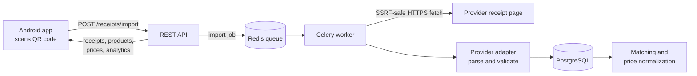

# Eksoda

**Household spending, built from the receipts you already get.**

Eksoda turns Greek electronic receipts into a searchable record of what a
household buys: every line item, product price histories, price comparisons
between shops, and monthly spending analytics. Receipts are added by scanning
the QR code printed on them. There is no typing and no photo OCR.

This repository contains the backend (a Django REST API with background
workers), the Android client that is being built against it, and the full
design documentation.

## Why

Greek retailers issue their receipts as electronic documents registered with
AADE's myDATA platform. The QR code on the paper slip links to that document,
either on the retailer's e-invoicing provider's site or on AADE's own check
page. The data is structured and exact, down to quantities, unit prices and
VAT, but each receipt sits on its own web page.

Eksoda collects those pages for a household and answers everyday questions:

- How much did we spend this month, and how does it compare with last month?
- Where does the money go: which shops and which categories?
- What did we pay for this product last time, and where is it cheapest?
- How has its price per kilo or per liter changed over time?

## Features

- **Receipt import from a link.** Submit the QR-code URL. A background job fetches the page, parses it, validates the totals and stores the receipt. Duplicate submissions, retries and concurrent imports never create a second copy.
- **Three receipt sources:**
  - Impact
  - Entersoft (used by LIDL and others)
  - the AADE cash-register check page

  Each source is an isolated adapter that maps the page to one canonical model aligned with myDATA. A new source or page layout is a self-contained change.
- **Line-level data.** Every line keeps its original description and amounts. Lines are classified as products, discounts and fees, such as bag fees and deposits.
- **Products and prices:**
  - Items become household products automatically.
  - Package sizes such as `1L` or `500G` are parsed, so prices are normalized per kg, liter or piece.
  - Each product has a price history and a comparison between shops.
  - Uncertain matches go to a review queue instead of being guessed.
- **Spending analytics:**
  - summary against the previous period
  - spending by category and by merchant
  - monthly trend and top products
  - figures that always reconcile with the receipt totals
- **Households:** owner and member roles, invite-only registration, and strict data isolation between households.
- **Operations:**
  - Docker-only development and deployment
  - health checks and structured JSON logs
  - optional Sentry
  - daily database backups with a tested restore
  - a Django admin for support work

## How it works



1. **Submission.** The client submits a receipt link. The API checks that the host belongs to a supported provider, records an import job, and answers immediately.
2. **Fetch and parse.** A worker fetches the page through a hardened fetcher:
   - provider host allowlist
   - public IP addresses only
   - no redirects
   - size and time limits

   The provider's adapter turns the page into a canonical receipt.
3. **Validate and store.** Totals, VAT and line sums are cross-checked. Discrepancies are recorded, never "corrected". The receipt, its merchant, store and lines are stored in one transaction.
4. **Matching.** Lines are matched to household products, and unit prices are normalized. Failed imports keep a stable error code and are retried on a schedule.

## Privacy and security

Receipts are personal data, and receipt links act as bearer credentials. The
design treats both accordingly:

- **Receipt links:**
  - stored only for the household that submitted them
  - never logged; logs carry the host and a fingerprint, and tests enforce this
  - scrubbed from error reports
- **Personal fields on receipt pages are never stored:**
  - customer or loyalty codes
  - card transaction ids
  - terminal ids
  - signatures

  Parsers read an allowlist of fields, not a blocklist.
- **Household isolation:** every household-scoped endpoint goes through one access path. A test enumerates every API route and fails if a new one is not covered by the isolation checks.
- **Accounts and abuse limits:**
  - Argon2 password hashing
  - short-lived JWT access tokens with rotating, revocable refresh tokens
  - rate limits on login, registration, imports and the admin login
  - request size limits

## Tech stack

| Area | Technology |
|---|---|
| API | Python 3.13, Django 5.2, Django REST Framework, drf-spectacular (OpenAPI 3) |
| Background jobs | Celery with Redis as the broker. Job state and retry schedule live in PostgreSQL |
| Database | PostgreSQL 17 |
| Parsing | BeautifulSoup and lxml, with strict decimal and date parsing for both Greek and English page variants |
| Deployment | Docker Compose, gunicorn, Caddy (HTTPS), scheduled `pg_dump` backups. Sized to run on a Raspberry Pi 4 |
| Quality | pytest with about 740 tests and 98% coverage, ruff, golden-file tests on sanitized real receipts |
| Android client | Kotlin, Jetpack Compose, Room, WorkManager, CameraX with ML Kit (in development) |

## Getting started

Docker (with Compose v2) and `make` are the only requirements.

```bash
git clone https://github.com/tsaklidis/eksoda.git && cd eksoda
make up                                                 # build and start the development stack
make bootstrap EMAIL=you@example.com HOUSEHOLD="Home"   # create the first user and household
```

Then open the interactive API documentation at
<http://localhost:8000/api/docs/>.

- **[Setup guide](docs/setup.md):** local development, trying the API end to end, daily commands and configuration.
- **[Deployment guide](docs/deployment.md):** production with HTTPS, backups and restore, monitoring, and running on a Raspberry Pi.

## Documentation

| Document | Contents |
|---|---|
| [Setup guide](docs/setup.md) | Running the project locally, using the API, development workflow |
| [Deployment guide](docs/deployment.md) | Production stack, backups, monitoring, operations runbook |
| [Requirements](docs/requirements.md) | Scope, decisions, data model, API and business rules |
| [Technical design](docs/technical-design.md) | Architecture, modules, algorithms, security controls, testing strategy |
| [Implementation plan](docs/implementation-plan.md) | Milestones, exit criteria and status |
| [Provider formats](docs/providers/) | The observed page formats of each supported receipt source |
| [Android app specification](docs/android-app.md) | The client's product and technical design, and the API it relies on |

## Project status

The server is feature-complete for its first release. Every milestone is done:

- foundation
- receipt providers
- import pipeline
- products and prices
- analytics
- operations hardening

It is designed for a single household and runs comfortably on a Raspberry Pi.

**Next:**

- the Android client, which is in development
- a web frontend
- more receipt sources as new formats appear

## Repository layout

```text
backend/            Django project: apps, settings, tests and sanitized receipt fixtures
  apps/receipts/    Import pipeline, fetcher, validation and provider adapters
  apps/products/    Products, matching, units and prices
  apps/analytics/   Spending queries
Android/            Android client (Kotlin, Jetpack Compose)
docs/               Requirements, design, plans and guides
ops/                Caddy configuration and backup script
compose*.yaml       Development and production stacks
Makefile            Every development and operations command
```
