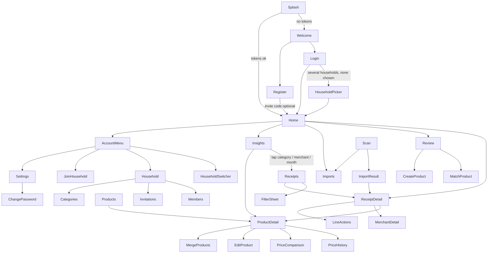

# Eksoda Android App: Product and Technical Specification

> Status: draft v1 (2026-11-15). This spec is based on the server API as it
> exists today (`/api/v1/`, OpenAPI at `/api/schema/`). The server is the
> contract (requirements D17). Where the app needs something the API does not
> offer yet, §15 lists it as a proposed server change. It is not assumed to
> exist.

## 1. Purpose

The Android app is the main way a household uses Eksoda day to day:

1. **Capture.** Scan the QR code on a Greek e-receipt and send its link to
   the server, in as few taps as possible.
2. **See.** Show where the money goes: this month against last month, by
   category, by merchant, over time.
3. **Find.** Browse, search and filter every receipt and every product.
4. **Compare.** Show what a product cost last time, how its price per kg or
   per liter changed, and which merchant is cheapest.
5. **Tidy up.** Resolve the few lines the server could not match to a
   product, and manage products, categories and the household.

Design goals, in priority order:

- **Friendly and calm.** Plain words, big readable numbers, no accounting
  jargon. "Spent this month" rather than "Σ gross totals".
- **Fast to capture.** From launching the app to a submitted receipt in
  two taps or fewer. Scanning a stack of receipts in a row must be easy.
- **Easy to navigate.** Four destinations plus Scan. Every number on a
  chart can be tapped to reach the receipts behind it.
- **Trustworthy.** Totals in the app always match the server. Money is
  never rounded wrongly. Receipt links are treated like passwords.

### 1.1 Out of scope for v1

These follow the server's scope (requirements §3.2): password reset by
email, social login, 2FA, budgets, shopping lists, OCR of paper receipts,
barcode scanning of products, CSV export, and expenses that do not come
from receipts. The UI must not suggest that any of these exist.

## 2. Users and key scenarios

| Persona | Scenario | What the app must make easy |
|---|---|---|
| **Household owner** | Sets up the household and invites a partner | Create an invite code, share it, see who joined |
| **Member** | Comes home with three receipts | Scan them in a row, see each one appear |
| **Anyone** | "How much did we spend on groceries this month?" | Home → Insights → tap the Groceries slice → receipts |
| **Anyone** | "Was milk cheaper at Lidl or AB?" | Search the product → price comparison |
| **The tidy one** | A badge says "4 items to review" | Resolve each line in one or two taps |

## 3. Technology

| Concern | Choice | Notes |
|---|---|---|
| Language | Kotlin (latest stable), coroutines and Flow | |
| UI | Jetpack Compose, Material 3 | Material You dynamic color on Android 12+, with a branded fallback palette |
| Navigation | Navigation Compose, type-safe routes | Deep links for `eksoda://receipt/{id}` and `eksoda://product/{id}` |
| DI | Hilt | |
| Networking | Retrofit and OkHttp, kotlinx.serialization | Clients and models are **generated from the OpenAPI schema** (§5.1) |
| Local data | Room (cache), DataStore (preferences) | |
| Secrets | Tokens in DataStore encrypted with Tink and an Android Keystore key | Never in plain SharedPreferences |
| Camera and QR | CameraX and ML Kit Barcode Scanning (bundled model, QR only) | Works offline and without Play Services updates |
| Background work | WorkManager | Offline import queue, checking pending imports |
| Charts | Vico (Compose) | Bar, line and donut-style charts |
| Paging | Paging 3 with a `RemoteMediator` | Receipts, products, imports and review lists |
| Images | None needed in v1 | Receipts have no images |
| Min / target SDK | minSdk 26, target the latest stable SDK | |
| Build | Gradle Kotlin DSL, version catalog | Flavors: `dev` (cleartext to `10.0.2.2:8000` allowed), `prod` (HTTPS only) |

### 3.1 Module layout

```
app/                       # Application, navigation graph, theme wiring
core/network/              # Generated API client, auth interceptor, error mapping
core/data/                 # Repositories, Room database, DTO↔domain mappers
core/model/                # Domain models (Money, Receipt, Product, Period, …)
core/designsystem/         # Theme, typography, components (MoneyText, CategoryIcon, …)
core/ui/                   # Shared screens pieces: empty/error/loading states, filter sheet
feature/auth/              # Welcome, login, register, join
feature/home/
feature/scan/              # Camera, paste link, share target, import queue
feature/receipts/          # List, filters, detail
feature/insights/          # Analytics
feature/products/          # List, detail, price history, comparison, merge, review
feature/household/         # Household, members, invitations, categories
feature/settings/          # Account, password, app preferences
```

Architecture is MVVM with unidirectional data flow: each screen has a
`ViewModel` that exposes one immutable `UiState` as a `StateFlow` and
accepts `UiEvent`s. Repositories are the only layer that calls the API.

## 4. Information architecture and navigation

### 4.1 Top-level structure

A bottom navigation bar with four destinations and a raised center
**Scan** button:

```
┌──────────────────────────────────────────────┐
│  Home   Receipts   ( ◉ Scan )   Insights   Products │
└──────────────────────────────────────────────┘
```

- **Home:** the dashboard. Also the entry point to Review and to the
  household and account menu (avatar, top right).
- **Receipts:** every receipt, with search and filters.
- **Scan:** opens the camera full screen. It is not a tab; it returns to
  the previous tab when closed.
- **Insights:** analytics for a chosen period.
- **Products:** every product, with price history and comparison.

On tablets and foldables (expanded width), use a navigation rail and a
list-detail layout for Receipts and Products.

### 4.2 Screen map



### 4.3 Navigation rules

- Back always goes one level up. Filters live in the URL-like route
  state, so Back from a receipt returns to the same filtered list and
  scroll position.
- Every drill-down from Insights opens **Receipts with filters already
  applied** and shows them as removable chips. The user can always see
  why the list looks the way it does.
- Bottom-sheet actions (filters, line actions, period picker) never
  navigate away on their own.

## 5. API integration

### 5.1 Client generation

- Generate the Retrofit interfaces and serializable models from
  `GET /api/schema/` (drf-spectacular, OpenAPI 3) with
  `openapi-generator` (`kotlin`, `jvm-retrofit2`,
  `serializationLibrary=kotlinx_serialization`).
- Commit the schema file into the Android repo. CI regenerates and fails
  if the generated code differs, so server changes are noticed.
- Generated DTOs stay in `core/network`. Map them to domain models in
  `core/data`. Screens never see DTOs.

### 5.2 Conventions the client must follow

| Topic | Rule |
|---|---|
| Base URL | `https://<host>/api/v1/`. Paths have **no trailing slash** (`/receipts`, not `/receipts/`) |
| Content type | JSON only, for requests and responses |
| Auth header | `Authorization: Bearer <access>` on every call except register, login and refresh |
| Household header | `X-Household-ID: <uuid>` on **every household-scoped call** (see §5.4), even when the user has one household |
| Money | Decimal values arrive as **strings** (`"12.40"`). Parse to `BigDecimal`. Never use `Double` or `Float`. Unit prices have 4 decimals |
| Dates | `issued_at` and other timestamps are ISO 8601 with an offset. Show them in the **household timezone** (`household.timezone`), not the device timezone |
| Date filters | `issued_from`, `issued_to`, `from`, `to`, `created_from`, `created_to` are `YYYY-MM-DD` dates, inclusive, in the household timezone |
| Pagination | `?page=&page_size=` (default 25, max 100). Responses are `{count, next, previous, results}` |
| Ordering | `?ordering=<field>` or `?ordering=-<field>` for descending |
| Errors | Always `{"error": {"code", "message", "details"}}`. Branch on `code`, never on `message` (§5.6) |
| Rate limits | `429 rate_limited` with `details.retry_after_seconds`. Show a friendly wait message |
| IDs | UUID strings everywhere |

### 5.3 Authentication and token lifecycle

| Endpoint | Use |
|---|---|
| `POST /auth/register` `{email, password, display_name?, invite_code?}` | Returns `201 {user, tokens: {access, refresh}}` |
| `POST /auth/login` `{email, password}` | Returns `{access, refresh}` |
| `POST /auth/refresh` `{refresh}` | Returns a **new** pair. The old refresh token is revoked (rotation) |
| `POST /auth/logout` `{refresh}` | `204`. Revokes the refresh token |
| `GET /auth/me` | `{id, email, display_name, memberships[{household_id, household_name, role, joined_at}], created_at}` |
| `POST /auth/password/change` `{old_password, new_password}` | `204`. **Revokes every refresh token of the user** |

Rules:

- Access tokens live about 15 minutes, refresh tokens about 30 days. Do
  not hard-code these. React to `401`.
- An OkHttp `Authenticator` refreshes on `401`. It must be
  **single-flight**: concurrent requests wait for one refresh, then
  retry with the new token. Because refresh tokens rotate, two parallel
  refreshes would revoke each other and log the user out.
- Save the new refresh token **atomically** before retrying requests.
- An expired access token answers `401 token_not_valid`. If the refresh
  call itself fails (`401 token_not_valid`: expired, revoked or already
  rotated), clear the session, keep
  the last email, and go to Login with "Your session expired. Please
  sign in again."
- After a password change, every refresh token is revoked. Immediately
  call `/auth/login` with the new password to get a fresh pair, so the
  user stays signed in on this device.
- Logout calls `/auth/logout`, then clears tokens, the Room cache and the
  import queue whatever the result.
- **Registration may be closed.** Without an invite code the server
  answers `400 invite_required` when open registration is off. The
  register screen therefore puts the invite code field up front, with
  "Got an invite code from your household?" as its label.
- Login is rate limited (about 5 per minute per account). After a
  `rate_limited` error, disable the button with a countdown from
  `retry_after_seconds`.
- Password rules come from the server (`details.password` is a list of
  messages). Show them under the field as they are.
- There is no password reset in v1. "Forgot password?" opens a short
  explanation: "Ask your household owner, or contact support."

### 5.4 Household context

- After login, call `GET /auth/me`.
  - One membership: select it silently.
  - Several: show the **Household picker** the first time, then
    remember the choice in DataStore.
  - None (left every household): show an empty state with **Join a
    household** (invite code).
- Send `X-Household-ID` on every household-scoped request, always. If
  the user joins a second household later, requests without the header
  would start failing with `400 household_required`.
- `403 household_forbidden` means the user is no longer a member. Drop
  the stored household, refresh `/auth/me`, and show the picker.
- **All cached data is keyed by household ID.** Switching households
  swaps the whole data set, with no mixing.
- Load `GET /households/{id}` once per session for `default_currency`,
  `timezone`, `name` and the user's `role`. Cache it. Use the role to
  show or hide owner-only actions. The server still enforces them
  (`403 owner_required`).

### 5.5 Endpoint map by feature

| Feature | Endpoints |
|---|---|
| Auth | `POST auth/register`, `auth/login`, `auth/refresh`, `auth/logout`, `auth/password/change`; `GET auth/me` |
| Household | `GET households`, `GET/PATCH households/{id}`, `POST households/join` |
| Members | `GET households/{id}/members`, `DELETE households/{id}/members/{member_id}` (remove, or leave when it is yourself) |
| Invitations | `GET/POST households/{id}/invitations`, `DELETE households/{id}/invitations/{invitation_id}` |
| Scan / import | `POST receipts/import`, `GET receipt-imports`, `GET receipt-imports/{id}`, `POST receipt-imports/{id}/retry` |
| Receipts | `GET receipts`, `GET/PATCH/DELETE receipts/{id}` |
| Products | `GET/POST products`, `GET/PATCH products/{id}`, `GET products/{id}/prices`, `GET products/{id}/price-comparison`, `POST products/{id}/merge` |
| Review | `GET receipt-items/review`, `PATCH receipt-items/{id}`, `POST receipt-items/{id}/match`, `POST receipt-items/{id}/create-product` |
| Categories | `GET/POST categories`, `GET/PATCH/DELETE categories/{id}` |
| Merchants | `GET merchants`, `GET merchants/{id}`, `GET stores` |
| Insights | `GET analytics/summary`, `analytics/spending-by-category`, `analytics/spending-by-merchant`, `analytics/monthly-trend`, `analytics/top-products` |

### 5.6 Error handling

One `ApiException(code, message, details, httpStatus)` type comes out of
the network layer. Screens map `code` to localized text. The server's
`message` is English and is used only as a fallback.

| Code (HTTP) | Where | User-facing text (EN) | UI behavior |
|---|---|---|---|
| `validation_error` (400) | Any form | Field messages from `details` | Show each message under its field |
| `invalid_request` (400) | Any | "Something went wrong with that request." | Snackbar |
| `invite_required` (400) | Register | "You need an invite code to join." | Focus the invite field |
| `invalid_invitation` (400) | Register, join | "That invite code isn't valid or has expired." | Inline under the code |
| `already_member` (409) | Join | "You're already in this household." | Switch to it |
| `invitation_not_pending` (409) | Revoke invite | "This invite was already used or revoked." | Refresh the list |
| `owner_required` (403) | Owner actions | "Only the household owner can do this." | Hide the action next time |
| `last_owner` (409) | Leave or remove | "A household needs at least one owner." | Explain how to transfer ownership via invite |
| `household_required` (400) | Any scoped call | Should never be seen | Bug: the header was missing. Log it, show the picker |
| `household_forbidden` (403) | Any scoped call | "You no longer have access to this household." | Show the picker |
| `not_found` (404) | Detail screens | "This item no longer exists." | Pop back and refresh the list |
| `invalid_url` (400) | Import | "That doesn't look like a receipt link." | Keep the camera open |
| `unsupported_provider` (422) | Import | "Receipts from this shop's provider aren't supported yet." | Keep the camera open |
| `unsupported_url_format` (422) | Import | "This receipt link has an unexpected format." | Keep the camera open |
| `not_retryable` (409) | Import retry | "This import isn't in a failed state." | Refresh the job |
| `not_a_product_line` (409) | Review | "This line isn't a product." | Refresh the line |
| `system_category` (403) | Categories | "Built-in categories can't be changed." | Hide edit for system categories |
| `category_in_use` (409) | Delete category | "Move its products to another category first." | Offer a filtered products list |
| `no_active_account` (401) | Login | "Wrong email or password." | Inline under the password |
| `not_authenticated` (401) | Any | Should never be seen | Bug: the auth header was missing. Go to Login |
| `token_not_valid` (401) | Any call, refresh | Access token expired: refresh silently. Refresh token rejected: "Your session expired." | Refresh once, else go to Login |
| `invalid_token` (400) | Logout | Ignore | Clear the local session anyway |
| `rate_limited` (429) | Any | "Too many attempts. Try again in {n} s." | Countdown |
| `internal_error` (500), network | Any | "We couldn't reach Eksoda. Check your connection." | Retry button, keep cached data on screen |

**Import job errors** arrive in `job.error.code` (not as HTTP errors).
They need their own friendly texts:

| `error.code` | Retries automatically | Text |
|---|---|---|
| `provider_unreachable`, `provider_timeout`, `provider_error` | yes | "The shop's receipt service isn't responding. We'll keep trying." |
| `receipt_not_found` | yes | "The receipt isn't published yet. Some shops send it later in the day. We'll keep trying." |
| `blocked_destination`, `response_too_large`, `unexpected_content_type` | no | "This link can't be imported." |
| `provider_format_changed` | no | "We can't read this receipt format yet. We've been told about it." |
| `inconsistent_source` | no | "The receipt data didn't check out." |
| `internal_error` | no | "Something went wrong on our side." |

## 6. Feature specifications

Each screen below lists what it shows, the endpoints it calls, and the
states it must handle. Every list screen has **loading** (skeleton
rows, not a spinner), **empty**, **error with retry**, and **offline**
(cached data with a "Showing saved data" banner) states.

### 6.1 Welcome, login, register, join

- **Welcome:** app name, a one-line promise ("Scan your receipts. See
  where the money goes."), and **Sign in** / **Create account** buttons.
- **Login:** email, password (with show/hide), and **Sign in**. The email
  is trimmed and lowercased by the server. Use autofill hints so
  password managers work.
- **Register:** invite code (optional, first), display name (optional),
  email, password. On success go straight to Home. The response already
  holds the tokens.
- **Join a household** (from the account menu, for signed-in users):
  one code field and `POST households/join {code}`. On `201`, refresh
  `/auth/me` and offer to switch to the new household.
- Invite codes can arrive as a link or text. Accept pasted text and
  trim whitespace.

### 6.2 Home (dashboard)

**Purpose:** a glance at this month, plus anything that needs attention.

```
┌────────────────────────────────────┐
│ Good evening, Maria         (MA) ▾ │  avatar → account menu
│ Home · November                    │  household name if >1
├────────────────────────────────────┤
│  Spent this month                  │
│  € 642,30                          │  large, tabular figures
│  ▼ 8% vs October (€ 698,10)        │  green when lower, amber when higher
│  ▁▃▅▂▆▄  (last 6 months)            │  sparkline, tap → Insights
├────────────────────────────────────┤
│ ⚠ 4 items to review            ›   │  hidden when 0
│ ⟳ 2 receipts importing…        ›   │  hidden when none pending
├────────────────────────────────────┤
│ Top categories                     │
│ 🥛 Dairy and eggs     € 120,40 ███ │
│ 🍞 Bakery             €  64,10 ██  │
│ ⛽ Fuel and transport €  60,00 ██  │  tap → Receipts filtered
├────────────────────────────────────┤
│ Recent receipts                    │
│ AB Vasilopoulos   Today 18:42  €32,10 │
│ Lidl              Mon          €18,95 │
│ See all ›                          │
└────────────────────────────────────┘
```

Calls, in parallel:

- `GET analytics/summary` (no params = current month). Use
  `current.spending`, `previous.spending`, `change.percent` and
  `needs_review_count`. `change.percent` may be `null` (previous was 0):
  show "First month with receipts" instead.
- `GET analytics/monthly-trend?months=6` for the sparkline.
- `GET analytics/spending-by-category` (current month). Show the top 3
  buckets with `bucket == "category"`.
- `GET receipts?page_size=5` for recent receipts.
- `GET receipt-imports?status=pending&page_size=10` for the importing
  strip.

Pull to refresh reloads everything. Home also refreshes when an import
completes (§6.3.4).

If `current.other_currency_receipts > 0`, show a small footnote: "3
receipts in other currencies aren't included."

### 6.3 Scan and import

This is the most important flow. It must feel instant.

#### 6.3.1 Camera screen

- Full-screen CameraX preview with a rounded viewfinder and the hint
  "Point at the QR code on your receipt".
- ML Kit decodes **QR codes only**. Pass on a code only when it parses
  as an `https://` URL. Anything else shows "That QR code isn't a
  receipt" for 2 seconds, and scanning continues.
- **Continuous mode is the default.** Each new code gives a haptic tick
  and a short sound (respecting silent mode). A chip slides up from the
  bottom ("✓ Sent: receipt 3"), and the camera keeps scanning. The same
  URL scanned again within the session is ignored on the device.
- Bottom bar: **torch** toggle, **paste link**, **import from photo**
  (ML Kit on a gallery image), and **Done** with a counter.
- Camera permission: explain first ("Eksoda uses the camera only to
  read receipt QR codes"). If the user denies it, offer paste and photo
  import instead.

#### 6.3.2 Submitting

- `POST receipts/import {"url": "<scanned url>"}` with `X-Household-ID`.
  The URL is sent exactly as scanned, not trimmed or re-encoded. The
  body must stay under 4 KB.
- Responses:
  - `202`: new import, or a failed import started again. Show
    "Importing…".
  - `200` with `duplicate: true`: already submitted. Show "Already
    imported" with **View** (`receipt_id`) when the job is completed.
  - `400/422`: show the error chip (§5.6). Keep scanning.
  - `429`: pause submitting, queue locally, and show "Slow down a moment".
- The response never contains the URL. The app must not keep it longer
  than needed (§10).

#### 6.3.3 Offline queue

- With no connection, the scanned URL goes into an **encrypted** Room
  table (`pending_imports`, encrypted with a Keystore key), and the chip
  says "Saved, will send when online".
- A WorkManager job with a `CONNECTED` constraint drains the queue,
  submits each URL, and **deletes the URL as soon as the server accepts
  or rejects it**. Each row stores the resulting job ID.

#### 6.3.4 Following import progress

The server has no push notifications. The app polls:

- **While the app is in the foreground** and some jobs are `pending`:
  poll `GET receipt-imports/{id}` (or the list with `status=pending`)
  every 3 s for the first 30 s, then every 15 s, then stop after
  5 minutes.
- **In the background:** a periodic WorkManager job (every 15 minutes,
  network required) checks jobs still `pending`. When a job becomes
  `completed`, post a local notification: "Receipt from AB
  Vasilopoulos imported · €32,10" (load `GET receipts/{receipt_id}` for
  the text). Tapping it opens Receipt detail. Notifications are opt-in
  and grouped when there are several.
- A `pending` job with `next_attempt_at` and an `error` is
  **retrying**. Show "Retrying at 18:05: the receipt isn't published
  yet."

#### 6.3.5 Imports screen

Reached from the Home strip, the scan **Done** summary, and Settings.

- `GET receipt-imports` (paginated, newest first) with a status filter:
  All · Importing · Failed · Done (`status=pending|failed|completed`).
- Each row shows: status icon, `source_host` (e.g. "impact.gr"), the
  merchant and total once completed, and the time.
- **Failed** rows show the friendly error and a **Retry** button
  (`POST receipt-imports/{id}/retry` → `202`).
- `outcome == "receipt_deleted"` shows "Receipt was deleted". Scanning
  the receipt again imports it again.

#### 6.3.6 Share target

Register an intent filter for `text/plain` `ACTION_SEND`. Users who scan
with Google Lens or the system camera can then share the link to
Eksoda. Show a small confirmation sheet ("Import this receipt into
Home?") and submit.

### 6.4 Receipts

#### 6.4.1 List

```
┌────────────────────────────────────┐
│ Receipts                    🔍  ⚙︎ │
│ [This month ×] [Dairy ×] [+ Filter]│  active filter chips
├────────────────────────────────────┤
│ TODAY                     € 32,10  │  sticky day headers with day totals
│ (AB) AB Vasilopoulos       € 32,10 │
│      Kifisias 12 · 14 items · Card │
│ MONDAY 11 NOV             € 18,95  │
│ (L)  Lidl                  € 18,95 │
│      7 items · Cash   ⚠ review     │
│ (S)  Shell               −€ 5,00   │  credit note: minus sign, "Refund" tag
└────────────────────────────────────┘
```

- `GET receipts` with filters and `ordering=-issued_at` (default). A sort
  menu offers newest, oldest, highest total, lowest total
  (`-issued_at`, `issued_at`, `-gross_total`, `gross_total`).
- Infinite scroll with Paging 3, `page_size=25`.
- Each row: merchant avatar (initials on a color derived from the
  merchant ID), `merchant.display_name`, store `name`/`street` when
  present, `item_count`, a payment method icon, and `gross_total`.
- Badges: `needs_review` → "Review", `has_warnings` → ⚠, `status ==
  "cancelled"` → struck-through total with a "Cancelled" tag,
  `document_kind == "credit_note"` → "Refund" with a minus sign,
  `excluded_from_analytics` → a muted "Not in stats" tag.
- Day header totals are worked out on the device from the loaded rows,
  as a convenience only. The authoritative totals live in Insights.
- **Swipe actions** (with undo snackbar): swipe left → delete (confirm
  first, §6.4.3), swipe right → toggle "exclude from stats".

#### 6.4.2 Search and filters

The search field maps to `q` ("Text in a line description or the
merchant name"), debounced 300 ms. The **filter sheet** (modal bottom
sheet) maps one-to-one to `ReceiptFilter`:

| UI control | Query parameter | Notes |
|---|---|---|
| Period presets: This month, Last month, Last 3 months, This year, Custom range | `issued_from`, `issued_to` | Dates in the household timezone; date range picker for Custom |
| Merchant (searchable list) | `merchant` | Options from `GET merchants?ordering=-receipt_count` |
| Store (shown after a merchant is chosen) | `store` | `GET stores?merchant={id}` |
| Category (chips with icons) | `category` | `GET categories` |
| Product (search) | `product` | `GET products?q=` |
| Amount range slider plus fields | `min_total`, `max_total` | Decimal strings |
| "Needs review" toggle | `needs_review=true` | |
| "Has warnings" toggle | `has_warnings=true` | |
| Type: All · Purchases · Refunds | `document_kind=sale` / `credit_note` | |
| "Hide cancelled" toggle | `status=active` | Off by default: cancelled receipts are listed, marked "Cancelled" |

- Active filters appear as removable chips above the list. **Clear all**
  resets.
- The last used filters are remembered per household (DataStore), but
  the period resets to "This month" on a new calendar month.
- When filters return nothing: "No receipts match these filters" and a
  **Clear filters** button.

#### 6.4.3 Receipt detail

```
┌────────────────────────────────────┐
│ ←  AB Vasilopoulos            ⋮    │
│    Kifisias 12, Marousi            │
│    Mon 11 Nov 2026, 18:42          │  "~18:40" if coverage.issue_time = approximate
│                                    │  date only if "date_only"
│            € 32,10                 │
│      Card · 14 items               │
├────────────────────────────────────┤
│ ⚠ The line totals don't add up     │  validation_warnings, expandable
├────────────────────────────────────┤
│ Items                              │
│ Milk 1L Delta        2 × 1,29  2,58│  tap → line sheet
│   1,29 €/l · Dairy and eggs        │  normalized price + product category
│ Bananas            0,812 kg   1,62 │
│   1,99 €/kg                        │
│ Discount                     −0,50 │  discount lines styled muted
│ Bag fee                       0,09 │
│ ● Feta (unmatched)            4,20 │  needs_review → "Review" pill
├────────────────────────────────────┤
│ Payment       Card € 32,10         │  payments[] ("derived" → "estimated")
│ VAT           13%: 2,10 · 24%: 1,90│  vat_breakdown
├────────────────────────────────────┤
│ Note                          ✎    │  user_note
│ Store                         ✎    │  store_id among the merchant's stores
│ Include in stats            [on]   │  excluded_from_analytics (inverted)
├────────────────────────────────────┤
│ Details ▾                          │  collapsed: document no., type code,
│                                    │  MARK, UID, provider, parser version
└────────────────────────────────────┘
```

- `GET receipts/{id}`. Lines come in `items` ordered by `line_number`.
- Line row: `description`, `quantity` × `unit_price`, `gross_amount`. A
  second line shows `normalized_unit_price` per `normalized_unit`
  ("€/kg", "€/l", "€/piece") when present, plus the product name if
  matched. Tapping a matched line opens **Product detail**.
- Line sheet (tap a line): **Open product**, **Change product** (match),
  **Create product from this line**, **Mark as not a product** (changes
  `line_type` to `discount`, `fee` or `other`), **Add note**.
- Overflow menu:
  - **Open original receipt.** Opens `source_url` in a Custom Tab
    **after** a confirmation that explains the link works like a
    password. Never copy it to the clipboard automatically. Never put it
    in a share intent.
  - **Delete receipt.** Confirm with "Delete this receipt? Its items
    leave your price history. You can import it again by scanning the
    QR code." Then `DELETE receipts/{id}`.
- Edits use `PATCH receipts/{id}` with only the changed field
  (`user_note` up to 2000 characters, `excluded_from_analytics`, or
  `store_id`). The response is the updated detail. Update the UI
  optimistically and roll back on error.
- `coverage.line_items == false`: show "This receipt type has totals
  only, no item list" instead of an empty item list.
- `status == "cancelled"`: a banner "This receipt was cancelled by the
  shop" (with `cancellation_mark` in Details).

### 6.5 Insights (analytics)

**Period selector** at the top (segmented control plus a "Custom" date
range): This month · Last month · 3 months · Year · Custom. It sets
`from`/`to` for every card below. Every response echoes `period` and
`currency`. Show the period in the header from the response, not from
the device's guess.

Cards, top to bottom:

1. **Summary.** `GET analytics/summary?from&to`.
   - Big number: `current.spending`. Below it: `receipt_count`
     receipts, average `average_sale`, and the change against
     `previous.period` (an equal-length period before).
   - `credit_notes_total` (when not zero): "Refunds: −€ 12,00".
2. **By category.** `GET analytics/spending-by-category?from&to`.
   - Donut chart plus a ranked list with `name`, `total` and `share` %.
   - Buckets always add up to `total`. Non-category buckets
     (`uncategorized`, `discounts`, `fees_deposits`,
     `other_adjustments`, `unallocated`) get neutral gray tones and sit
     at the bottom of the list.
   - Tap a category → Receipts with `category={id}` and the period.
     Non-category buckets are not tappable (no matching receipt filter).
     `uncategorized` instead links to Products, to assign categories.
3. **By merchant.** `GET analytics/spending-by-merchant?from&to`.
   - Horizontal bars, top 5 plus "Show all". Tap → Receipts with
     `merchant={id}`.
4. **Monthly trend.** `GET analytics/monthly-trend?months=12&to=<period end>`.
   - Bar chart, one bar per month. Empty months are 0 and must still
     appear. Tap a bar → sets the period to that month.
5. **Top products.** `GET analytics/top-products?from&to&by=count|spend&limit=10`.
   - A "Most bought / Most spent" toggle. Tap → Product detail.

All five calls run in parallel. Each card loads and fails on its own
(skeleton or retry per card). Cache the last result per (household,
period) in Room for offline viewing.

Explain the numbers in plain words with an ⓘ tooltip on the summary:
"Spending is the total of your receipts. Refunds count as negative.
Receipts you excluded, cancelled receipts and receipts in other
currencies are left out."

### 6.6 Products

#### 6.6.1 Product list

- `GET products?q=&category=&brand=&merchant=&ordering=name`, paginated.
- A search field (accents and case are ignored by the server, so
  "γαλα" finds "Γάλα"). Filter chips: category, merchant ("bought at").
- Row: category icon, `name`, `brand`, and `line_count` ("bought 12
  times").
- FAB **New product** → create form (`POST products`).

#### 6.6.2 Product detail

```
┌────────────────────────────────────┐
│ ←  Milk 1L                    ✎ ⋮  │
│    Delta · Dairy and eggs · 1 l    │
├────────────────────────────────────┤
│ Last paid      € 1,29 / l          │  stats.latest (+ arrow vs previous)
│ Lowest  1,15   Highest 1,45        │  stats.minimum / maximum
│ Average 1,27  (12 purchases)       │  stats.average (quantity-weighted)
│ [ kg | l | piece ]                 │  unit switch only when several stats
│  price-over-time line chart        │
├────────────────────────────────────┤
│ Where it's cheapest                │
│ 1 Lidl           1,18 €/l  (avg)   │  rank, from price-comparison
│ 2 AB             1,31 €/l          │
│ 3 Sklavenitis    1,35 €/l          │
├────────────────────────────────────┤
│ Purchase history                   │
│ 11 Nov  AB, Kifisias   2 × 1,29    │  tap → receipt
│ 02 Nov  Lidl           1 × 1,19    │
└────────────────────────────────────┘
```

- `GET products/{id}`, `GET products/{id}/prices` (paginated entries
  plus `stats[]` per `normalized_unit`/`currency`), and
  `GET products/{id}/price-comparison`.
- The chart plots `normalized_unit_price` against `issued_at` for the
  chosen unit. Load enough pages for the chart (up to 100 entries per
  page), and filter with `issued_from`/`issued_to` for long histories.
- **Comparison states:**
  - `comparable == true`: ranked list (`rank` 1 = cheapest average).
  - `reason == "one_merchant"`: "Only bought at Lidl so far."
  - `reason == "unknown_unit"`: "Add a package size to compare prices
    per kg or liter." with an **Edit product** shortcut.
  - `reason == "no_prices"`: hidden.
  - When `available_units` has more than one entry, show a unit switch
    (`normalized_unit` query param).
- **Edit** (`PATCH products/{id}`): `name`, `brand`, `category_id`,
  `package_quantity` + `package_unit` (both or neither). Warn: "Changing
  the package size recalculates the price per unit of every purchase."
- **Merge** (overflow): "These are the same product". Multi-select other
  products (search), then `POST products/{id}/merge
  {source_product_ids: [...]}` (max 50). Confirm: "3 products will be
  merged into Milk 1L and deleted. Their purchase history moves here."

### 6.7 Review

Reached from the Home card, receipt badges, and the Products tab
overflow. The title is friendly: **"Help us match these items"**.

- `GET receipt-items/review` (paginated, newest receipt first).
- Each card: `description`, `receipt.merchant_name`, date,
  `quantity`/`unit`, `gross_amount`, `merchant_product_code` (small,
  muted).
- Actions on each card:
  1. **Match to a product** → search sheet (`GET products?q=` prefilled
     with the description) → `POST receipt-items/{id}/match
     {product_id}`. Copy: "Future receipts from this shop will match
     automatically."
  2. **New product** → a create form prefilled with the description as
     the name → `POST receipt-items/{id}/create-product {name, brand?,
     category_id?, package_quantity?, package_unit?}`.
  3. **Not a product** → choose Discount / Fee / Other →
     `PATCH receipt-items/{id} {line_type}`.
- Resolved cards animate out. The Home badge count goes down. When the
  queue is empty, celebrate gently: "All caught up ✓".

### 6.8 Merchants

No separate tab. Merchants are reached from receipt detail, Insights
and filters.

- **Merchant detail:** `GET merchants/{id}` gives `display_name`,
  `legal_name`, `vat_number`, address, `default_category`,
  `receipt_count` and `last_receipt_at`. Stores come from
  `GET stores?merchant={id}`. Buttons: "See receipts" (Receipts
  filtered by merchant), "Open in Maps" (address intent).
- The merchant picker in filters uses `GET merchants?ordering=-receipt_count`
  so the most frequent shops come first. There is no server-side search
  for merchants (§15). Filter the loaded pages on the device.

### 6.9 Household, members, invitations, categories

From the avatar menu:

```
(MA) Maria Papadopoulou
     maria@example.com
──────────────────────
✓ Home                    ← household switcher (if >1)
  Parents' house
──────────────────────
Household settings
Join another household
Imports
Settings
Sign out
```

- **Household settings** (`GET households/{id}`; owners can
  `PATCH {name, default_currency, timezone}`). Currency is a searchable
  ISO 4217 list. Timezone is a searchable list that defaults to
  `Europe/Athens`. Members see these values read-only.
- **Members** (`GET households/{id}/members`): name, email, role badge.
  Owners can remove others (`DELETE …/members/{member_id}`). Everyone
  sees **Leave household** at the bottom (DELETE with their own member
  ID). Handle `last_owner`.
- **Invitations** (owners only):
  - `GET households/{id}/invitations` lists status (`pending`,
    `accepted`, `revoked`, `expired`) and `expires_at` ("expires in 5
    days").
  - **Invite someone** → choose role (member/owner) →
    `POST …/invitations {role}` → a full-screen sheet with the `code` in
    a large monospace font, **Copy** and **Share** buttons, and a clear
    warning: "This code is shown only once and works for 7 days."
  - Revoke a pending invite: `DELETE …/invitations/{invitation_id}`.
- **Categories** (`GET categories`, flat list, with `product_count`):
  - System categories (`is_system`) show a lock icon. They cannot be
    edited.
  - Household categories can be created (`POST {name}`), renamed
    (`PATCH`) and deleted (`DELETE`, handling `category_in_use`).

### 6.10 Settings and account

- **Account:** display name and email (read-only in v1, §15). **Change
  password** (old, new, confirm). After success, sign in again silently
  (§5.3).
- **Appearance:** theme (System / Light / Dark), dynamic color on/off.
- **Language:** System / Ελληνικά / English (per-app language API).
- **Notifications:** "Tell me when a receipt finishes importing".
- **Privacy:** optional **app lock** with biometrics or device
  credential when the app returns from the background.
- **About:** version, server host, open-source licenses.
- **Sign out.**

## 7. Visual design

### 7.1 Principles

- **Numbers first.** Money is the hero: large, with tabular (monospaced)
  figures so columns line up.
- **Soft and rounded.** Material 3 shapes (large corner radii on cards),
  generous spacing (16 dp gutters, 24 dp between sections), gentle
  elevation.
- **Color carries meaning.** Green means less spent or cheaper. Amber
  means more spent. Red is only for errors and destructive actions.
  Never use red for "spent more", which would feel like blame.
- **Friendly copy.** Short sentences, second person, no codes or IDs on
  primary screens. Technical fields (MARK, UID, document type code,
  parser version) live under a collapsed "Details" section.

### 7.2 Theme

| Token | Light | Dark | Use |
|---|---|---|---|
| Primary | Teal 600 `#00897B` | Teal 200 `#80CBC4` | Scan button, primary actions, selected nav |
| Secondary | Indigo 400 | Indigo 200 | Charts' second series, chips |
| Positive | Green 700 | Green 300 | "Spent less", cheapest merchant |
| Caution | Amber 800 | Amber 300 | "Spent more", warnings, review badges |
| Error | M3 error | M3 error | Errors, delete |
| Surface | M3 surface tones | M3 surface tones | Cards use `surfaceContainerLow` |

With dynamic color on, primary and secondary follow the wallpaper. The
semantic colors (positive, caution, category colors) stay fixed so
meaning never changes.

**Typography:** the system font (Roboto Flex where available, which has
good Greek glyphs). Money uses `fontFeatureSettings = "tnum"`. Sizes:
display 36 sp for hero totals, title 22 sp, body 16 sp, labels 12–14 sp.

### 7.3 Category look

The server's categories have no icon or color, so the app maps **system
category slugs** to an icon and a color:

| Slug | Icon (Material Symbols) | Color |
|---|---|---|
| `groceries` | `shopping_basket` | Green |
| `dairy-and-eggs` | `egg` | Light blue |
| `meat-and-fish` | `set_meal` | Red-orange |
| `fruits-and-vegetables` | `nutrition` | Lime |
| `bakery` | `bakery_dining` | Amber |
| `beverages` | `local_cafe` | Brown |
| `frozen-food` | `ac_unit` | Cyan |
| `snacks-and-sweets` | `cookie` | Pink |
| `cleaning-products` | `cleaning_services` | Teal |
| `personal-care` | `spa` | Purple |
| `household-items` | `chair` | Blue gray |
| `pet-supplies` | `pets` | Orange |
| `restaurants-and-cafes` | `restaurant` | Deep orange |
| `pharmacy-and-health` | `medication` | Red |
| `fuel-and-transport` | `local_gas_station` | Indigo |
| `clothing-and-footwear` | `checkroom` | Deep purple |
| `electronics-and-appliances` | `devices` | Blue |
| `services` | `handyman` | Gray |
| `other` | `category` | Neutral |

Household categories get a generic `label` icon and a color picked from
a 12-color palette by a stable hash of the category ID. Chart palettes
must stay distinguishable in both themes and for common color-vision
deficiencies. Always pair color with a label or icon.

### 7.4 Core components (`core/designsystem`)

- `MoneyText(amount: BigDecimal, currency, style, signed = false)`:
  formats with the app locale (`12,40 €` in Greek, `€12.40` in
  English). Credit notes and discounts show a true minus sign (−).
- `UnitPriceText(price, normalizedUnit)` → "1,29 €/kg".
- `ChangeBadge(percent, amount)` → ▲/▼ with semantic color, or "—"
  when null.
- `MerchantAvatar(id, name)`, `CategoryIcon(category)`.
- `FilterChipRow`, `PeriodSelector`, `FilterSheet`.
- `SectionCard`, `StatTile`, `EmptyState(illustration, title, action)`,
  `ErrorState(retry)`, `SkeletonList`.
- `ReceiptRow`, `LineItemRow`, `ImportJobRow`, `ReviewCard`.

### 7.5 Motion and feedback

- Shared-element transitions from a receipt row to receipt detail (the
  total and the merchant name).
- Charts animate in once per load, not on every recomposition.
- Haptics: a light tick on a successful scan, a confirm pattern on
  delete.
- Respect "Remove animations" in system settings.

### 7.6 Empty states (first-run matters)

| Screen | Empty copy | Action |
|---|---|---|
| Home (no receipts) | "Scan your first receipt to start seeing where your money goes." | **Scan a receipt** |
| Receipts | "No receipts yet." | **Scan** |
| Insights | "Insights appear after your first few receipts." | — |
| Products | "Products are created automatically when you import receipts." | — |
| Review | "All caught up ✓" | — |
| Imports | "Nothing importing right now." | — |

## 8. Localization and formatting

- Ship **Greek and English** from day one. All strings live in
  resources. No string concatenation for sentences; use plurals
  (`<plurals>`) for counts ("1 receipt", "3 receipts").
- Receipt descriptions and merchant names come from the receipts
  (usually Greek). Show them as they are; never translate them.
- Money: format with `NumberFormat.getCurrencyInstance(appLocale)` and
  `Currency.getInstance(household.default_currency)`. Analytics totals
  are always in the household currency (`response.currency`).
- Dates: `java.time` with `ZoneId.of(household.timezone)`. Relative
  labels for recent dates ("Today", "Yesterday", weekday names within a
  week), then "11 Nov" and "11 Nov 2025" for older years.
- Quantities: show up to 3 decimals for kg and l, and none for whole
  pieces.
- Server error `message` values are English. Always prefer a local
  string mapped from `code` (§5.6).

## 9. Offline behavior and caching

| Data | Cache | Freshness |
|---|---|---|
| Session, chosen household, household settings | DataStore (encrypted for tokens) | Refresh on app start |
| Receipts list (first pages per filter set) | Room via `RemoteMediator` | Refresh on open and on pull |
| Receipt detail | Room | Show the cached copy, refresh in the background |
| Insights per period | Room (JSON blobs keyed by household and period) | Refresh on open |
| Products, categories, merchants | Room | Refresh on open, at most every 5 minutes |
| Pending scans | Encrypted Room table | Deleted when submitted |

- Writes (PATCH, DELETE, review actions) need a connection in v1. Without
  one, disable the action with "You're offline". Only scans are queued.
- Cache cleanup: on sign-out, on household switch (other households'
  data may stay, keyed by ID, but is never shown mixed), and an LRU cap
  on receipt details (e.g. 500).

## 10. Security and privacy

- **Receipt URLs work like passwords** (anyone with the link can open
  the receipt page). The app must:
  - never log them (no Timber or Logcat), and keep OkHttp body logging
    **off in release builds**. In debug builds, redact the `url` field
    of `POST receipts/import` and the `source_url` field of receipt
    detail;
  - keep them only in the encrypted pending queue, and delete them once
    submitted;
  - not cache `source_url` in Room (fetch the detail again when the user
    asks to open the original);
  - never include them in crash reports or analytics events.
- Tokens are encrypted at rest. Set `android:allowBackup` rules to
  **exclude** tokens and caches from cloud backup.
- `FLAG_SECURE` on the invite code sheet (the code is shown only once).
- HTTPS only in the `prod` flavor (network security config).
- The server runs on the home network and the VPN only (`docs/deployment.md`).
  - Its certificate comes from the server's own local CA, not a public one.
  - The prod network security config must trust that CA for the server's
    domain. Preferred: bundle the exported root (`make prod-ca`) as
    `res/raw/eksoda_root_ca` in a `<domain-config>` trust anchor, which
    also pins the app to this CA.
  - Fallback: allow user-installed CAs for that domain only.
- Crash reporting (if used) scrubs URLs, emails and receipt contents.
- No third-party analytics SDKs in v1.

## 11. Accessibility

- Touch targets at least 48 dp. Content descriptions on every icon
  button and chart.
- Charts have an accessible alternative: each chart card offers "View
  as list" with the same numbers.
- Money is read correctly by TalkBack ("12 euros 40 cents"): set
  semantic text explicitly for `MoneyText`.
- Support font scaling up to 200% without clipping. Hero numbers wrap or
  shrink, never cut off.
- Contrast at least WCAG AA in both themes. Color is never the only
  signal (▲/▼ arrows, labels).

## 12. Performance targets

| Metric | Target |
|---|---|
| Cold start to Home with cached data | < 1.5 s on a mid-range device |
| Camera open from tapping Scan | < 500 ms |
| QR decoded to request sent | < 300 ms |
| List scrolling | No dropped frames (Baseline Profiles for the main flows) |
| APK/AAB size | < 15 MB download |

## 13. Testing

- **Unit tests:** ViewModels (Turbine for flows), mappers (decimal
  strings → `BigDecimal`, timezone conversion, credit-note signs), and
  the token refresh authenticator (concurrent 401s → exactly one
  refresh).
- **API contract tests:** MockWebServer with JSON responses captured
  from the dev server (`make manage ARGS="seed_demo_data --household <id>"`)
  and checked against the
  committed OpenAPI schema.
- **UI tests:** Compose UI tests for scan → import result, filters →
  list, review actions, and login errors.
- **Screenshot tests:** Roborazzi or Paparazzi for key screens in light
  and dark, English and Greek, and at 200% font scale.
- **Manual QA checklist:** real receipts from each supported source
  (Impact, Entersoft, AADE cash-register page), a stack of 10 receipts
  in continuous mode, airplane mode scanning, two-household switching,
  and an expired session.

## 14. Delivery milestones

Build in this order. Each milestone ends with a working, installable app.

| # | Milestone | Contents | Exit criteria |
|---|---|---|---|
| A1 | Foundation | Project setup, modules, theme, generated API client, auth (login, register, refresh, logout), household context | Sign in against the dev server; `/auth/me` shown; the token refresh test passes |
| A2 | Capture | Camera scanning (continuous), paste, share target, import submit, imports screen, retry, foreground polling | 10 receipts scanned in a row all appear as imports; duplicates are reported |
| A3 | Receipts | List with paging, search, the full filter sheet, receipt detail, edit note/store/exclude, delete | Every `ReceiptFilter` parameter is reachable from the UI |
| A4 | Insights and Home | Dashboard, Insights cards, drill-downs to Receipts | Home totals equal `analytics/summary`; every chart element drills down |
| A5 | Products and Review | Product list and detail, price history chart, comparison, edit, merge, review queue | A needs-review line can be matched, created or reclassified |
| A6 | Household and polish | Members, invitations, categories, settings, offline queue, background notifications, app lock, Greek translation, accessibility pass, Baseline Profiles | Accessibility checklist passes; airplane mode scan is sent later |

## 15. Server API gaps and proposed changes

These are not blockers for v1. The app works around each one. Each needs
the owner's decision and, if accepted, a server task recorded in
`docs/implementation-plan.md`.

| # | Gap | v1 workaround in the app | Proposed server change |
|---|---|---|---|
| G1 | No push when an import finishes | Foreground polling plus a 15-minute WorkManager check | Optional FCM push on job completion (needs a device-token endpoint) |
| G2 | Categories have no icon or color | Client mapping by system slug (§7.3), hashed colors for household categories | Optional `icon` and `color` fields on categories |
| G3 | No search on `GET merchants` | Filter the loaded pages on the device | Add `q` to the merchant filter (display and legal name) |
| G4 | The display name cannot be changed (`/auth/me` is read-only) | Read-only display name | `PATCH /auth/me {display_name}` |
| G5 | A user cannot create another household (only by invite or at registration) | Join by invite only | `POST /households {name}` creating the caller as owner |
| G6 | No receipt filter for the non-category buckets (`uncategorized`, `discounts`, …) | Those buckets are not tappable | A `bucket` filter on receipts or receipt items |
| G7 | No combined "import job with merchant and total" view | One extra `GET receipts/{id}` per completed job | Add `merchant_name` and `gross_total` to completed jobs |
| G8 | No password reset (out of scope by design, §3.2) | An explanation screen | Revisit after v1 |
| G9 | No account deletion endpoint (required for Play Store listing with accounts) | A support contact link | `DELETE /auth/me` with data handling rules. **Needed before a public Play Store release** |

## 16. Glossary for the app team

| Term | Meaning in the app |
|---|---|
| Receipt | An imported e-receipt (sale, credit note, or other document) |
| Line / item | One row of a receipt. `line_type` is `product`, `discount`, `fee` or `other` |
| Product | The household's own product that lines are matched to (e.g. "Milk 1L") |
| Review | Product lines the server could not match safely (`match_status = needs_review`) |
| Normalized price | The price per kg, per liter or per piece, so different package sizes compare fairly |
| Import job | The background task that fetches a receipt from its link. `pending` → `completed` or `failed` |
| Household | The group whose receipts are shared. Everything in the app belongs to the current household |
