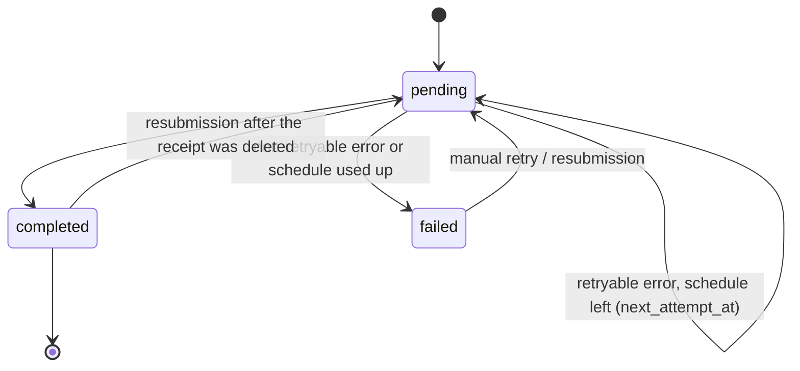

# Household Expense & Receipt Intelligence Platform

## Requirements and Technical Specification: Server (v2)

**Version:** 2.1 (2.0 replaced the original v1.0 specification; 2.1 trims the MVP for a single household, D21)
**Date:** 2026-11-13, revised 2026-11-14
**Locale:** Greece · **Currency:** EUR · **Language:** English for the
application and code; Greek receipt content fully supported.

**Companion documents**

- `docs/requirements-review.md`: issues found in v1 and why they changed
- `docs/providers/impact.md`: the observed Impact receipt format
- `docs/implementation-plan.md`: milestones and tasks
- `docs/technical-design.md`: how it will be built (containers, modules,
  models, services, tests)

All decisions in section 4 were confirmed by the product owner on
2026-11-13.

---

## 1. Purpose

Build the backend of a household expense application. The primary input
is the URL in the QR code printed on Greek retail receipts. A separate
Android app scans the code and submits the URL.

The backend retrieves the electronic receipt from its provider and
extracts every available field. It normalizes the data into a
provider-independent model aligned with AADE myDATA and stores it with
full traceability. On top of that data it offers search, price history,
price comparison and spending analytics.

Questions the product must answer:

- How much did the household spend this month, and how does that
  compare with last month?
- How much was spent at each merchant and store, and in each category?
- What did we pay for a product last time, and where was it cheapest?
- How has the price per kg or per liter changed over time?

## 2. Glossary

| Term | Meaning |
|---|---|
| **AADE** | Greek Independent Authority for Public Revenue |
| **myDATA** | AADE's digital bookkeeping platform. Every e-receipt is registered there with a common data model and code lists |
| **MARK** (Μ.Αρ.Κ.) | Unique registration number that AADE assigns to every document. Nationally unique |
| **UID** | 40-hex document identifier, derived from issuer VAT, date, branch, type, series and number |
| **Cancellation MARK** | MARK of a document that cancels the receipt. Non-zero means the receipt is cancelled |
| **Document type** | myDATA code, e.g. `11.1` retail sales receipt, `11.4` retail credit note |
| **Branch number** | myDATA installation number (Αρ. Εγκατάστασης) of the issuing shop. `0` usually means head office |
| **Provider** | A certified e-invoicing provider that hosts the receipt page (first: Impact) |
| **Merchant** | The legal entity that issued the receipt, identified by VAT number |
| **Store** | A physical branch of a merchant |
| **Merchant item code** | The merchant's internal product code printed on the line |
| **Canonical receipt** | The provider-independent representation produced by a provider adapter |
| **Household** | The ownership and data-isolation boundary for all purchase data |

## 3. Scope

### 3.1 This phase: server MVP

1. Email/password authentication for the Android app and a future web
   client.
2. Households with owner/member roles, invitations, and strict data
   isolation.
3. Receipt URL submission API with asynchronous import jobs.
4. Receipt sources behind a provider-independent interface: Impact,
   Entersoft (D19) and the AADE cash-register check page (D20).
5. SSRF-safe fetching.
6. Persistence of receipts, lines, merchants and stores, with
   idempotency and duplicate protection.
7. Line classification (product, discount, fee, …).
8. Household products and categories, conservative matching, review and
   correction APIs, and product merge.
9. Price history with unit normalization, and price comparison.
10. Receipt, product, merchant and category query APIs with filters and
    pagination.
11. Spending analytics.
12. Import status, retry, operational logging, health checks, Django
    admin.
13. Automated tests (parsing, validation, idempotency, authorization,
    end-to-end).
14. Everything runs in Docker: development, tests, linting, dependency
    locking, backups and deployment. The host needs only Docker.

### 3.2 Out of scope for this phase

- The user-facing web frontend is deferred. The API is designed
  to support it, and the Django admin serves as the interim operations
  and review UI.
- Password reset by email, social login, 2FA.
- Inventory, shopping lists, meal planning, budgets, recurring bills.
- Barcode scanning, external product databases, OCR of paper receipts.
- Sources other than Impact, Entersoft and the AADE cash-register check
  page (D19 and D20). New formats will keep appearing, so adding a
  source or a layout must stay a provider-only change (§7.4).
- Re-checking receipts after import to detect later cancellations.
- AI recommendations or conversational analytics.
- CSV/Excel export.

### 3.3 The architecture must not prevent

More providers (all of them share the myDATA data model), several
households per user, merchant aliases per household, exports, receipt
attachments, barcodes and package data, inventory and shopping lists,
price alerts, and expenses that do not come from receipts.

## 4. Decisions

| ID | Topic | Decision (default) | Status |
|---|---|---|---|
| D1 | Phase scope | Backend only. The Django admin is the interim operations and review UI | Confirmed by request |
| D2 | Registration | Invite-only. Registering requires a household invitation code unless `REGISTRATION_OPEN=true`. The first owner is created with a management command | Confirmed 2026-11-13 |
| D3 | Auth | JWT access tokens plus rotating refresh tokens (`djangorestframework-simplejwt`, blacklist on). Access token: 15 min. Refresh token: 30 days | Technical |
| D4 | Receipt identity | MARK, with a fallback of (issuer country, VAT, UID). **Unique per household.** Two households may each import the same receipt independently. Nothing ever reveals that another household holds it | Confirmed 2026-11-13 |
| D5 | Duplicate submission | Returns `200` with the existing import. `409` is never used for imports | Technical |
| D6 | Product ownership | Products and mappings belong to a household. Categories are either system-wide or per household | From v1 §4.4 |
| D7 | New product lines | Always auto-create a household product for each new merchant item code (or description, when there is no code), so price history works immediately. There is no setting to turn this off | Confirmed 2026-11-13, simplified 2026-11-14 (D21) |
| D8 | Price basis | Gross (VAT-inclusive) effective paid price. Net and VAT are kept too | From v1 |
| D9 | Source retention | Keep the canonical extraction (personal data removed) for the receipt's lifetime. Raw HTML is never stored: a failed page is reproduced with `make parse-receipt SRC=<url>` while the link still works | Confirmed 2026-11-13, simplified 2026-11-14 (D21) |
| D10 | Receipt deletion | Hard delete of the receipt and its lines. The import job is kept with outcome `receipt_deleted`. Resubmitting the URL imports it again | Confirmed 2026-11-13 |
| D11 | Merchant and store data | Global, public business data. Read-only for users and curated by staff in the admin. Users only see merchants and stores that appear on their own household's receipts | Technical |
| D12 | Time | Store UTC. `Household.timezone` (default `Europe/Athens`) defines periods and how times are displayed | Technical |
| D13 | Cancellations and credit notes | Cancelled receipts are kept but excluded from analytics and price history. Credit notes count as negative spending and are not in price history | Technical |
| D14 | Platform | Python 3.13, Django 5.2 LTS, PostgreSQL 17, Redis 7, Celery 5.5 | Technical |
| D15 | Search | Substring search on normalized text (`normalize_text`, §9.5) in PostgreSQL. No external search engine. The `pg_trgm` and `unaccent` extensions are already enabled (M1) and are used only if substring search proves too weak | Technical, simplified 2026-11-14 (D21) |
| D16 | Runtime | Everything is dockerized (Docker Compose for development and production). No tooling is installed on the host | Confirmed 2026-11-13 |
| D17 | Client contract | The server defines the API. The Android app (built later) adopts it. OpenAPI is the contract | Confirmed 2026-11-13 |
| D18 | Source control | The project owner initializes git manually. Implementation never runs `git init` | Confirmed 2026-11-13 |
| D19 | Entersoft provider | Support Entersoft receipts (`e-invoicing.gr`, e.g. LIDL) with line items and real line discounts. Missing myDATA codes are derived from labels and rates; time of issue is approximate (`docs/providers/entersoft.md`) | Confirmed 2026-11-14 |
| D20 | Receipts without lines | Accept summary-only receipts from the AADE cash-register check page (`www1.aade.gr/tameiakes`): merchant, store, date and time, totals, VAT breakdown, no products. They count in spending analytics, not in price history (`docs/providers/aade.md`) | Confirmed 2026-11-14 |
| D21 | Size the MVP for a household | The app serves one family (tens of receipts a week), not many tenants. M3–M6 were trimmed before implementation: a three-state import job with one retry schedule and no sweeper; no raw snapshots, unsupported-host table, classification-rule table, merge log or price-observation table; detailed myDATA amounts kept in the receipt's `source_data` JSON instead of columns; flat categories, with the merchant's default category as the fallback for spending by category; no fuzzy match suggestions; no staff stats endpoint. Each item can come back if real use shows the need | Confirmed 2026-11-14 |

## 5. Users, households and permissions

- **User:** email (unique, case-insensitive) and password. Uses a custom
  Django user model from the first migration.
- **Household:** owns receipts, products, mappings, household
  categories and analytics.
- **Membership:** (household, user, role). Unique per pair. Roles:
  - `owner`: everything a member can do, plus managing members,
    invitations and household settings.
  - `member`: view and manage receipts, products, reviews and analytics.
- **Invitations:** an owner creates a single-use code that expires after
  7 days. Only a hash of the code is stored. A new user registers with
  the code, or an existing user joins with it.
- **Bootstrap:** `manage.py bootstrap_household --email … --household …`
  creates the first owner.
- The last owner of a household cannot leave it or be removed.

**Isolation rules (mandatory)**

1. Every household-owned row has a direct `household_id`, or a
   mandatory parent that has one.
2. All API querysets go through one scoping mechanism
   (`HouseholdScopedMixin`). No view builds its own unscoped queryset.
3. Objects that belong to another household return **404**, never 403.
   They are indistinguishable from objects that do not exist.
4. Background tasks take only a job ID and read the household from the
   job row.
5. Write endpoints never accept `household_id` in the body. The
   household comes from the request context (§12.2).

## 6. Receipt ingestion

### 6.1 Input

The URL from the QR code is the only input and the only trusted source
of receipt data.

### 6.2 Import API

`POST /api/v1/receipts/import`

```json
{ "url": "https://einvoice.impact.gr/p/EL094062259/FA83…029F/63B5…2EA5" }
```

Submitting is idempotent by itself: the same receipt URL always maps to
the same job (§6.3), so the client needs no separate idempotency key.

Request validation:

- JSON body of at most 4 KB. URL of at most 2048 characters.
- Scheme `https`, no userinfo, no explicit port other than 443, and no
  fragment.
- The host must belong to a registered provider, and the path must match
  that provider's pattern. Hex segments are compared case-insensitively
  and canonicalized to uppercase.

Responses:

| Case | Status | Body |
|---|---|---|
| New receipt identity for this household | `202` | the import (§12.4) with `"status": "pending"`, `"receipt_id": null`, `"duplicate": false` |
| Same identity already submitted by this household (not failed) | `200` | the existing import, `"duplicate": true` |
| Same identity, previous job `failed`, or its receipt was deleted | `202` | the same import set back to `pending`, `"duplicate": true` |
| Malformed or oversized JSON, or a malformed URL | `400` | `invalid_request` / `invalid_url` |
| No `url` field | `400` | `validation_error` |
| Host not supported | `422` | `unsupported_provider` |
| Supported host, unknown path format | `422` | `unsupported_url_format` |
| Missing or invalid token | `401` | |
| Household header not allowed | `403` | `household_forbidden` |
| Rate limited | `429` | with `Retry-After` |

The API creates the job and enqueues it after the transaction commits.
It never fetches during the request.

### 6.3 Receipt identity and duplicate detection

Detection runs in two phases:

1. **Before fetching (URL identity).** The provider extracts a stable
   identity from the URL. For Impact this is
   `{country}:{issuer_vat}:{UID}`. The constraint
   `UNIQUE(household, provider_code, url_identity)` on
   `ReceiptImportJob` turns repeat submissions, including concurrent
   ones, into a single job. A request that loses the race catches the
   integrity error and returns the existing job.
2. **After parsing (receipt identity).** The constraints
   `UNIQUE(household, mark) WHERE mark IS NOT NULL`,
   `UNIQUE(household, issuer_country, issuer_vat, uid) WHERE uid IS NOT NULL`
   and `UNIQUE(household, source_key) WHERE source_key IS NOT NULL` on
   `Receipt` protect against duplicates that reach the database another
   way (a different URL form or a different provider). `source_key`
   identifies receipts that have no MARK or UID, e.g.
   `fhm:<register>:<sequence>` for cash-register receipts. If a match
   exists, the job completes with outcome `duplicate` and points to the
   existing receipt.

A worker crash or a task that runs twice can never create a second
receipt, because the database constraints are the final guard.

### 6.4 Import job lifecycle



- **`pending`** covers waiting, fetching, parsing and persisting. While
  a retry is scheduled the job is still `pending`, with
  `next_attempt_at` and `last_error_code` set, so the client can show
  "retrying".
- `outcome` (set when the job completes): `created` or `duplicate`. It
  becomes `receipt_deleted` if the user deletes the receipt later.
- **Product review is not an import state.** An imported receipt is
  `completed` even when some lines need review. Review is tracked on the
  lines (§9).

Error codes are stable, safe to show to users, and documented in the
OpenAPI schema:

| Code | Automatic retry | Meaning |
|---|---|---|
| `provider_unreachable` | yes | DNS or connection failure |
| `provider_timeout` | yes | Connect, read or overall timeout |
| `provider_error` | yes | 408, 429 or 5xx response |
| `receipt_not_found` | yes | Not-found page. The receipt may not be published yet |
| `blocked_destination` | no | SSRF guard rejected the resolved address |
| `response_too_large` | no | Over the size limit |
| `unexpected_content_type` | no | Not HTML |
| `provider_format_changed` | no (manual after a parser fix) | Unknown page structure, missing required fields, a redirect, or another unexpected HTTP status |
| `inconsistent_source` | no (manual) | The two views disagree, or the page identity does not match the URL |
| `internal_error` | no (manual) | Unexpected exception. Details go to logs and Sentry only |

### 6.5 Retry policy

- **One schedule** for every retryable error: about 1 min, 5 min,
  30 min, 2 h, 6 h and 24 h after the failed attempt (7 attempts in
  all). The long tail covers receipts that are published late, such as
  fuel receipts transmitted at the end of the day.
- **Manual retry** (`POST …/retry` or resubmitting the URL) is allowed
  for any `failed` job. It sets the job back to `pending` and resets
  `attempt_count`, so the full schedule applies again.
- **The database is the scheduler.** A retry is stored as
  `next_attempt_at`, and a beat task runs due jobs every minute (§14).
  Broker countdowns/ETAs are not used, because long ETAs are unreliable
  with a Redis broker.

### 6.6 Processing pipeline

1. **API:** authenticate, resolve the household, validate the URL,
   recognize the provider, compute the URL identity, create or reuse the
   job, and enqueue it on commit.
2. **Claim (short transaction):** lock the job row with
   `SELECT … FOR UPDATE SKIP LOCKED`. Continue only if it is `pending`
   and due. Increase `attempt_count` and move `next_attempt_at` a few
   minutes ahead as a lease: if the worker dies, the beat task picks the
   job up again when the lease ends. No other state is needed.
3. **Fetch** through the SSRF-safe fetcher (§15.1), outside any
   transaction.
4. **Parse:** the provider classifies the page (receipt, not found or
   unknown) and produces a `CanonicalReceipt`.
5. **Validate:** fatal rules fail the job. Warnings are recorded (§10.2).
6. **Persist, in a single database transaction:** resolve the merchant
   and store, check identity constraints, create the receipt and its
   lines, classify the lines, match products, compute normalized prices,
   and set the job to `completed`.
7. **On failure:** roll back, then record the error code and message
   and either the next attempt or `failed`, in a short transaction.

A failed import never leaves partial purchase data behind.

## 7. Provider architecture

### 7.1 Interface

```python
class ReceiptProvider(Protocol):
    code: str                          # "impact"
    hosts: frozenset[str]              # {"einvoice.impact.gr"}

    def recognize(self, url: ParsedUrl) -> UrlIdentity | None: ...
    def fetch(self, identity: UrlIdentity, fetcher: SafeFetcher) -> FetchedDocument: ...
    def parse(self, doc: FetchedDocument, identity: UrlIdentity) -> CanonicalReceipt: ...
        # raises ReceiptNotFound | FormatChanged | InconsistentSource
```

- A registry maps hosts to providers. Unknown hosts are rejected at the
  API.
- Providers are pure: no database access and no Django models. They can
  be tested with fixtures alone.
- The core (pipeline, persistence, matching) only sees
  `CanonicalReceipt`.

### 7.2 Canonical receipt (provider-independent, aligned with myDATA)

All values are immutable dataclasses with `Decimal` amounts.

- **Issuer:** country, VAT, legal name, activity, tax office, GEMI
  number, head-office address.
- **Branch:** number, address. Optional.
- **Document:** kind (`sale`, `credit_note`, `other`), type code (myDATA;
  empty when a source prints only a label) and label, series, number,
  formatted number, `issued_at` (aware datetime, Europe/Athens source),
  `issued_date`, currency.
- **Identity:** MARK, UID, cancellation MARK, transmission-failure flag,
  and `source_key` for sources without MARK or UID.
- **Totals:** net, VAT, withheld, fees, other taxes, stamp duty, digital
  transaction fee, deductions, gross, gross before discount, and
  discount. Plus a VAT breakdown per rate.
- **Payments:** canonical method (`card`, `cash`, `bank`, `other`),
  myDATA code, label, amount, tip, and `derived` (inferred, e.g. cash =
  total − card). No transaction identifiers.
- **Lines** (may be empty for summary-only sources): line number, line
  type code, annotation code, merchant item code, barcode, description,
  quantity, canonical unit and the source unit code and label, unit
  price and its basis (`gross`/`net`/`unknown`), gross before discount,
  discount, net, VAT category code, VAT rate, VAT, withheld, fees, other
  taxes, stamp duty, deductions, gross (after discount), VAT exemption
  code, and raw fields.
- **Coverage:** what the source provides:
  - `line_items`
  - `line_tax_amounts`
  - `official_codes` (myDATA codes, as opposed to codes derived from
    labels)
  - `mydata_registered` (whether a MARK is expected)
  - `issue_time` (`exact`, `approximate` or `date_only`)
  - `cross_checked` (two independent renderings were compared)

  Validation and analytics adapt to it.
- **Notices:** conditions the provider detected that the user should
  see, e.g. a QR signature that differs from AADE's record. They become
  validation warnings.
- **Metadata:** provider code, parser version (= layout name), detected
  culture, `unknown_fields`, and `provider_payload` (the allowlisted
  structured extraction with no personal data).

### 7.3 Impact adapter

The format details are in `docs/providers/impact.md`. The binding rules
are:

- Allowed host `einvoice.impact.gr`. Path pattern
  `^/p/[A-Z]{2}\d{9}/[0-9A-F]{40}/[0-9A-F]{32}$`, case-insensitive.
  A supported host with any other path returns `422
  unsupported_url_format`.
- Fetch with **no cookies**, so the page renders in the default Greek
  culture. Detect the culture and parse numbers and dates strictly for
  it. An undetermined culture means `provider_format_changed`.
- Classify the page by its content. The not-found page returns HTTP
  200.
- Parse the commercial view (`field-*` classes) and the tax view (label
  tables), then cross-check them. Any disagreement, or a UID or VAT that
  differs from the URL, means `inconsistent_source`.
- Use the tax view for identifiers, codes and amounts. Use the
  commercial view for unit price (VAT-inclusive), unit label, VAT %,
  names, addresses and time of day.
- Unknown tax-view labels are kept in `unknown_fields` and counted as
  format drift (§16), but do not cause a failure.
- Drop personal data during parsing (§15.3).
- **Before finalizing the parser, collect more real receipts** covering
  the unknowns in `docs/providers/impact.md` §7.

### 7.4 Adding a provider

New formats will keep appearing, so the system is built for change.
The procedure is the `add-provider` skill.

- **A new source** needs a provider package (URL recognition, fetch,
  one or more layouts, a sanitizer), a registry entry, a doc in
  `docs/providers/`, sanitized fixtures with meta files, and tests. No
  model, pipeline or API changes should be needed. If one is needed,
  the canonical model is missing a field. Fix the canonical model, not
  the core.
- **A changed page** gets a **new layout** next to the old one (layouts
  are tried newest first). Old fixtures keep passing, and each receipt
  records the layout that parsed it.
- **New labels** (document types, units, payment methods, currencies)
  are added to the shared vocabularies (`apps/receipts/vocabulary.py`).
  Unknown labels never crash a parser: they become `other`/empty values
  and are reported as format drift.
- **A new real receipt** becomes a test by adding a sanitized page and a
  meta file: the fixture harness discovers it.
- **Unsupported hosts** are logged (host only, never the URL), and
  failed imports keep their error code, so new formats are visible. A
  failing page is reproduced with `make parse-receipt` (D9).

Sources implemented: Impact (`docs/providers/impact.md`), Entersoft
(`docs/providers/entersoft.md`) and the AADE cash-register check page
(`docs/providers/aade.md`).

## 8. Data model

Conventions: UUID primary keys for every API-visible entity. Every table
has `created_at`/`updated_at`. Precision follows §10.1. Foreign keys to
household-owned data use `CASCADE` from the household.

### 8.1 User (`accounts`)

`id`, `email` (unique on `lower(email)`), `password`, `display_name`,
`is_active`, `is_staff`, `created_at`, `updated_at`.

### 8.2 Household (`households`)

`id`, `name`, `default_currency` (`EUR`), `timezone` (`Europe/Athens`),
`created_at`, `updated_at`.

### 8.3 HouseholdMember and HouseholdInvitation

- **HouseholdMember:** `id`, `household`, `user`, `role`
  (`owner`|`member`), `joined_at`. Unique `(household, user)`.
- **HouseholdInvitation:** `id`, `household`, `code_hash`, `role`,
  `created_by`, `expires_at`, `accepted_by` (nullable), `accepted_at`,
  `revoked_at`.

### 8.4 Merchant (`merchants`, global)

The legal entity that issued the receipt. It is not a retail brand: one
legal entity can operate several brands.

`id`, `country_code` (`GR`), `vat_number` (digits only, no `EL`
prefix), `legal_name`, `display_name` (initially derived from
`legal_name`, staff-editable), `activity_description`, `tax_office`,
`gemi_number`, `street`, `street_number`, `city`, `postal_code`,
`default_category` (nullable, system category, staff-set),
`details_as_of` (issue time of the receipt that last set the details),
`created_at`, `updated_at`.

Unique `(country_code, vat_number)`. Public fields are refreshed from
receipts: an empty field is filled from any receipt, and a filled field
is replaced only by a receipt issued at the same time or later, never by
a truncated copy of itself (some sources cut long names). The display
name is the legal name without its legal form (`METRO ΑΕΒΕ …` →
`Metro`) and follows the legal name until staff change it.

### 8.5 Store (`merchants`, global)

`id`, `merchant`, `branch_number` (nullable), `display_name` (blank
until staff set it), `street`, `city`, `postal_code`, `country_code`,
`normalized_address`, `details_as_of`, `created_at`, `updated_at`.

Unique `(merchant, branch_number)` when `branch_number` is set. Without
a branch number, the store is matched on its normalized address (street,
number, postal code and city) under the merchant, which is unique too.
If there is no address, the receipt has no store. Details are refreshed
like the merchant's.

### 8.6 Receipt (`receipts`)

Only what the API filters, sorts or aggregates on is a column.
Everything else the source provides stays in `source_data`.

| Field | Notes |
|---|---|
| `id`, `household`, `imported_by` (SET_NULL) | Import jobs point to the receipt (`ReceiptImportJob.receipt`). Several jobs may resolve to the same receipt (outcome `duplicate`) |
| `merchant` (PROTECT), `store` (nullable) | |
| `provider_code`, `parser_version` | |
| `issuer_country`, `issuer_vat`, `uid` (nullable), `mark` (nullable), `cancellation_mark` (nullable), `source_key` (nullable) | identity. `source_key` identifies receipts without MARK/UID (e.g. `fhm:<register>:<sequence>`) |
| `document_kind` (`sale`\|`credit_note`\|`other`), `document_type_code` (nullable), `document_number` | |
| `issued_at` (timestamptz) | |
| `currency` | ISO 4217 |
| `gross_total`, `net_total` (nullable), `vat_total` (nullable), `discount_total` (nullable) | source values, never altered |
| `payment_method` (`card`\|`cash`\|`bank`\|`mixed`\|`other`\|`unknown`) | no transaction identifiers |
| `status` (`active`\|`cancelled`) | `cancelled` when the cancellation MARK is non-zero |
| `validation_warnings` (JSON) | §10.2. Empty means no warnings |
| `excluded_from_analytics` (bool), `user_note` | user-editable |
| `source_url`, `source_url_fingerprint` (SHA-256) | sensitive (§15.3) |
| `source_data` (JSONB) | the canonical receipt (§7.2) without `source_url`: other myDATA amounts (withheld, fees, other taxes, stamp duty, digital fee, deductions), VAT breakdown, payments, coverage, notices, series and labels, raw line values, `provider_payload` and `unknown_fields`. Personal data is already removed by the parser |

Whether a receipt needs review is computed from its lines (any
`needs_review` line), not stored.

Constraints: `UNIQUE(household, mark) WHERE mark IS NOT NULL`,
`UNIQUE(household, issuer_country, issuer_vat, uid) WHERE uid IS NOT NULL`
and `UNIQUE(household, source_key) WHERE source_key IS NOT NULL`.
Indexes: `(household, issued_at DESC)`,
`(household, merchant, issued_at)`.

### 8.7 ReceiptItem (`receipts`)

| Field | Notes |
|---|---|
| `id`, `receipt`, `household` (denormalized, equals `receipt.household`) | |
| `line_number` | source line number. Unique per receipt |
| `line_type` (`product`\|`discount`\|`fee`\|`other`) | §9.1 |
| `description`, `normalized_description` | the original is never modified |
| `merchant_product_code` | nullable |
| `quantity` (nullable), `unit` (`piece`\|`kg`\|`l`\|`other`, nullable), `unit_price` (nullable) | |
| `gross_amount`, `net_amount`, `vat_rate`, `vat_amount`, `discount_amount` | source values, immutable. `gross_amount` is after any line discount. Only `gross_amount` is required |
| `product` (nullable; a product used by lines cannot be deleted), `match_status` (`matched`\|`needs_review`\|`not_a_product`) | §9.2 |
| `normalized_quantity`, `normalized_unit` (`kg`\|`l`\|`piece`\|`other`), `normalized_unit_price` | derived (§11.1). Nullable |
| `user_note` | |

Check constraint: `product_id IS NOT NULL` exactly when `match_status`
is `matched`; `match_status = not_a_product` exactly when `line_type` is
not `product`.
Indexes: `(household, match_status)`, `(product)`.

### 8.8 Product (`products`, household-scoped)

`id`, `household`, `name`, `normalized_name`, `brand`, `category`
(nullable), `package_quantity`, `package_unit`
(`g`|`kg`|`ml`|`cl`|`l`|`piece`), `created_at`, `updated_at`.

Package quantity and unit are both set or both empty. Variants (size,
flavor, fat %, formulation, brand) are separate products. Products are
never merged automatically. Barcodes are left for later: no supported
source prints them.

### 8.9 ProductCategory (`products`)

`id`, `household` (null means a system category), `name`, `slug`. The
list is flat.

System seed (in a data migration): Groceries; Dairy and eggs; Meat and
fish; Fruits and vegetables; Bakery; Beverages; Frozen food; Snacks and
sweets; Cleaning products; Personal care; Household items; Pet supplies;
**Restaurants and cafés; Pharmacy and health; Fuel and transport;
Clothing and footwear; Electronics and appliances; Services**; Other.
The API cannot change system categories. Households can add their own.

### 8.10 MerchantProductMapping (`products`, household-scoped)

Remembers which household product a merchant item corresponds to.

`id`, `household`, `merchant`, `merchant_product_code` (nullable),
`normalized_description`, `last_seen_description`, `product`.

Unique `(household, merchant, merchant_product_code)` when the code is
set. Unique `(household, merchant, normalized_description)` when it is
not. For a code mapping, `last_seen_description` and
`normalized_description` follow the latest description matched to it.

### 8.11 ReceiptImportJob (`receipts`)

`id`, `household`, `requested_by`, `provider_code`, `url_identity`,
`submitted_url`, `url_fingerprint`, `issuer_vat` (from the URL when the
provider puts it there, otherwise from the parsed receipt), `status`
(`pending`|`completed`|`failed`), `outcome`, `attempt_count`,
`next_attempt_at`, `last_error_code`, `last_error_message`, `receipt`
(nullable), `created_at`, `updated_at`, `finished_at`.

`UNIQUE(household, provider_code, url_identity)`.
Index: `(status, next_attempt_at)`.

## 9. Line classification, product matching and normalization

### 9.1 Line classification

Each line gets one of four types. The first matching rule wins:

1. A negative gross amount: `discount` if the description matches a
   discount keyword, otherwise `other` (returns, adjustments).
2. Keyword rules on the normalized description, kept as a list in
   `receipts/classification.py`: `ΕΚΠΤΩΣ`, `ΚΟΥΠΟΝ`, `DISCOUNT` →
   `discount`; `ΠΕΡΙΒΑΛΛΟΝΤΙΚ ΤΕΛ` (carrier-bag environmental fee) and
   `ΕΓΓΥΗΣ` (deposit) → `fee`. A keyword matches the start of a word; a
   two-word keyword matches two consecutive words. Never use the bare word `ΣΑΚΟΥΛ`: real
   LIDL receipts sell bags and garbage bags as products
   (`docs/providers/entersoft.md` §5). New keywords are a code change
   with a test.
3. Zero net amount with only fee or tax amounts → `fee`.
4. Everything else → `product`.

Users can reclassify any line. Non-product lines are never linked to
products and never get a normalized price.

### 9.2 Matching

Matching applies to `product` lines, scoped to the household and the
receipt's merchant. The key is the merchant item code, or the
normalized description when the line has no code.

| Step | Signal | Result |
|---|---|---|
| 1 | A mapping exists for (merchant, key) | `matched` to the mapping's product, and the mapping remembers the line's description. **Guard** (code keys only): if the normalized description is too different from the mapping's last seen one (similarity below 0.4, a setting), the merchant may have reused the code → `needs_review`, no product, mapping unchanged |
| 2 | No mapping | Create a product (name = original description, no category, package size parsed per §9.4 for `piece` lines) and a mapping → `matched` (D7) |

On real LIDL receipts, two tuna salads share one code at the same price
(similarity 0.47: matched as one item), while an unrelated item under a
reused code scores about 0.2 (review).

A concurrent import of the same new item is resolved by the mapping's
unique constraint: the loser reuses the winner's mapping. There are no
fuzzy suggestions in this phase (D21).

### 9.3 Review and corrections

- **Edit a product:** name, brand, category or package size.
- **Link a line** to an existing product. This also moves the line's
  mapping to that product, so future imports from that merchant match
  automatically. If the previous product is left with no lines and no
  mappings, it is deleted.
- **Create a product from a line**, with the same mapping behavior.
- **Reclassify** a line's type. A line that leaves `product` loses its
  product and price; a line set back to `product` is matched again.
- **Merge products** within a household. This is how the same product
  bought at different merchants gets linked. Merging moves the sources'
  mappings and lines to the target, recomputes the moved lines'
  normalized prices (with the target's package size), and deletes the
  sources. Nothing else is recorded.
- Corrections never change source amounts or original descriptions.
  Changing a product's name or category never rewrites historical
  receipt data.

### 9.4 Units and package sizes

- **Purchase units** come from myDATA measurement unit codes. The
  official table (AADE myDATA API v1.0.9, appendix 8.13) defines only
  `1` pieces, `2` kg and `3` liters. Any other code becomes `other`. The
  source code and label are always kept.
- **Package units:** `g`, `kg`, `ml`, `cl`, `l`, `piece`. Conversions:
  g→kg ÷1000, mg→kg ÷10⁶, ml→l ÷1000, cl→l ÷100. Mass and volume are
  never converted into each other.
- **Purchased quantity is not package size.** A weighed line (unit kg or
  l) gives the measured quantity directly, and package size does not
  apply. A piece line gives a count of packages. The price per kg or
  liter then needs the product's package size.
- **Package-size parsing** from descriptions only proposes values. It is
  applied automatically only when the description contains exactly one
  size token and no multipack (`6X330ML`) or slash (`27/250ML`)
  pattern. Percentages (`1,5%`) are never read as sizes. Otherwise the
  size stays empty until the user sets it. A size may follow an
  abbreviation dot (`ΦΥ.Ζ.195G`), and unit letters may be Latin or
  Greek look-alikes (`ΦΥΛ1ΚG`). Only `piece` lines get a suggestion.

| Description | Parsed package |
|---|---|
| `ΚΟΖΑΝΗΣ ΦΡΕΣΚΟ ΓΑΛΑ ΠΛΗΡΕΣ 1L` | 1 l |
| `ΚΟΖΑΝΗΣ ΦΡΕΣΚΟ ΓΑΛΑ ΕΛΑΦΡΥ 1,5% 1L` | 1 l (`1,5%` ignored) |
| `MY GUSTO ΧΥΜΟΣ MULTIV. 9 ΦΡΟΥΤΑ 27/250ML` | none (ambiguous) |
| `ADORO LIGHT 10% ΦΡΑΤΖ. …` with unit kg | variable weight, no package |

### 9.5 Text normalization

Normalization produces matching and search keys only. It never replaces
the original text. Steps:

1. Apply Unicode NFKC.
2. Uppercase.
3. Strip diacritics (Greek tonos and dialytika).
4. Map look-alike letters by script: within a mostly Greek token, Latin
   A, B, E, H, I, K, M, N, O, P, T, X, Y, Z become their Greek
   equivalents, and the reverse applies within Latin tokens.
5. Treat a decimal comma as a dot inside numeric tokens.
6. Collapse punctuation and whitespace.

Descriptions may be truncated (around 40 characters at Impact), so
matching must not require full-name equality across merchants.

## 10. Money, taxes and validation

### 10.1 Representation

| Value | Type |
|---|---|
| Money amounts | `Decimal(12,2)` |
| Unit prices, normalized unit prices | `Decimal(14,4)` |
| Quantities | `Decimal(14,4)` |
| Normalized quantities | `Decimal(16,6)` |
| VAT rate | `Decimal(5,2)` |
| Currency | ISO 4217 code, stored on every receipt |

- Never use `float` anywhere in the money path, including parsing and
  JSON. The API serializes amounts as strings.
- Source values are stored exactly as the receipt shows them and are
  never re-rounded.
- Derived values (normalized prices, averages) are computed at full
  precision and rounded `ROUND_HALF_UP` only for display.
- Number parsing is strict per culture. For `el`: thousands separator
  `.`, decimal separator `,`. For `en`: the reverse. Ambiguous strings
  are rejected.

### 10.2 Validation

Fatal rules fail the import. Warnings are stored in
`receipt.validation_warnings` as `{code, message, line_number,
expected, actual}` and returned in the API. Source values are never
altered to make a rule pass.

| Rule | Check | Tolerance | On failure |
|---|---|---|---|
| R1 | UID and issuer VAT in the page equal those in the URL | exact | **fatal** `inconsistent_source` |
| R2 | Commercial and tax views agree (line count, per-line net/VAT/gross, totals) | exact | **fatal** `inconsistent_source` |
| R3 | Required fields present (§7.3) | — | **fatal** `provider_format_changed` |
| R4 | Per line: net + VAT + fees + other taxes + stamp duty + digital fee − withheld − deductions = gross | 0.01 | `line_amount_mismatch` |
| R5 | Per line: round(qty × unit price, 2) = gross (when the basis is gross and the line has no discount) | 0.01 | `unit_price_mismatch` |
| R6 | Per line: net × VAT rate = VAT | 0.01 | `vat_rate_mismatch` |
| R7 | Sum of line net, VAT and gross equals the receipt totals | 0.02 | `total_mismatch` |
| R8 | Receipt: gross = net + VAT + fees + other taxes + stamp duty + digital fee − withheld − deductions | 0.01 | `receipt_amount_mismatch` |
| R9 | Sum of per-rate VAT equals the VAT total | 0.01 | `vat_breakdown_mismatch` |
| R10 | Sum of payments (excluding tips) equals gross | 0.01 | `payment_mismatch` |
| R11 | MARK present unless the transmission-failure flag is set | — | `mark_missing` |
| R12 | Currency is EUR | — | `non_eur_currency` (stored anyway) |
| R13 | Per line: gross before discount − discount = gross | 0.01 | `discount_mismatch` |
| R14 | Per VAT breakdown entry: net × rate = VAT | 0.01 | `vat_breakdown_rate_mismatch` |
| R15 | The document kind is recognized | — | `unknown_document_type` |
| R16 | Total before discount − discount = gross | 0.01 | `total_discount_mismatch` |
| — | Provider notices (e.g. `signature_mismatch`, `amount_mismatch`) | — | the notice code |

Rules follow the receipt's coverage:
- R7 compares only values that every line provides.
- R11 applies only to myDATA-registered documents.
- Summary-only receipts skip the line rules.
- R5 compares against the value before discount when the source gives
  it.
- Single-rendering sources (Entersoft) enforce their own arithmetic as
  fatal `inconsistent_source` checks in the parser: Σ lines = total,
  Σ discounts = discount total, VAT analysis = net/VAT totals.

The R4 and R8 formulas follow the myDATA total definitions. Confirm them
against more receipt samples.

### 10.3 Discounts and special lines

The model represents item-level discounts, receipt-level discounts,
coupons, deposits, fees, returns and negative adjustments as classified
lines (§9.1). None of these lines are discarded, and none count as
products.

- A line-level discount printed on the line itself (Entersoft) is
  already deducted from the line's `gross_amount`, so it lowers that
  item's price. Separate discount lines (coupons, receipt-level
  discounts) are **not allocated** to items. They appear as their own
  bucket in analytics.

## 11. Price history and comparison

### 11.1 Normalized unit price

Every `product` line with a product gets a normalized price, stored on
the line itself (§8.7). There is no separate observation table: price
history is a query over receipt items.

| Purchase | Normalized quantity / unit |
|---|---|
| Unit kg or l (weighed or measured) | quantity in kg or l |
| Piece, and the product has a package size | quantity × package size (in kg or l) |
| Piece, no package size | quantity, in `piece` |
| Other or unknown units | quantity, in `other` |

`normalized_unit_price = gross_amount / normalized_quantity`. It is null
when the quantity is zero or unknown, never a misleading value.

One function, `refresh_prices(items)`, recomputes these fields. It runs
on import and after a link, product creation from a line, merge,
reclassification or package-size change.

**Price history includes** only lines whose receipt is `active` and a
`sale`, with quantity > 0 and gross > 0. This is a query filter, so a
receipt that changes status needs no resync.

### 11.2 Statistics, for a product and period, per normalized unit

Latest price, previous price, minimum, maximum, count, and the
**quantity-weighted average** Σ gross ÷ Σ normalized quantity. Each
entry carries its merchant, store, date and receipt ID.

### 11.3 Comparison rules

Prices are compared only when they have the same product (after
merges), the same `normalized_unit` and the same currency. The
comparison returns statistics per merchant. It ranks merchants only when
at least two merchants have prices in the same normalized unit and
period. Otherwise it returns `comparable: false` with a reason:
`no_prices`, `one_merchant`, or `unknown_unit` (prices in the `other`
unit are never ranked). A shop is never presented as cheaper on the
basis of incompatible units or variants.

One comparison covers one (normalized unit, currency) group: the
requested `normalized_unit`, else the group with the most entries. The
response lists every group in `available_units`.

## 12. API

### 12.1 Conventions and authentication

- Base path `/api/v1/`, JSON, UTF-8, snake_case.
- Authentication: `Authorization: Bearer <access>`.
- Pagination: `page` and `page_size` (default 25, maximum 100). Results
  come as `{count, next, previous, results}`.
- Errors: `{"error": {"code": "unsupported_provider", "message": "…",
  "details": {…}}}`. Field validation errors go in `details`. Codes are
  stable and documented. Responses never include stack traces or
  internal details.
- Amounts and quantities are strings, always next to `currency`.
  Datetimes are ISO 8601 in the household's timezone.
- OpenAPI via drf-spectacular at `/api/schema/` and `/api/docs/`.

| Endpoint | Notes |
|---|---|
| `POST /auth/register` | `{email, password, display_name, invite_code}`. The invite is required unless registration is open. Django password validators apply |
| `POST /auth/login` | → `{access, refresh}`. Rate-limited per IP and email |
| `POST /auth/refresh` | Rotates the refresh token |
| `POST /auth/logout` | Blacklists the refresh token |
| `GET /auth/me` | The user and their memberships |
| `POST /auth/password/change` | |

### 12.2 Household selection

A household-scoped request may send `X-Household-ID`. Without the header,
the user's only membership is used. A user with several memberships who
omits it gets `400 household_required`. A household that does not exist
and one the user does not belong to both give the same
`403 household_forbidden`.

### 12.3 Households

`GET /households`, `GET|PATCH /households/{id}` (PATCH is owner-only:
name, timezone, currency), `GET /households/{id}/members`,
`DELETE /households/{id}/members/{member_id}` (owner, or the member
themselves to leave), `POST|GET /households/{id}/invitations`,
`DELETE /households/{id}/invitations/{inv_id}`,
`POST /households/join` `{code}`.

### 12.4 Imports

`POST /receipts/import` (§6.2), `GET /receipt-imports` (filter by
`status`, `created_from` and `created_to`), `GET /receipt-imports/{id}`,
`POST /receipt-imports/{id}/retry` (`failed` jobs only, then `202` with
the import; otherwise `409 not_retryable`).

The import representation includes `id`, `status`, `outcome`,
`provider_code`, `source_host`, `issuer_vat` (null until known),
`attempt_count`, `next_attempt_at` (set only while a retry is
scheduled), `error {code, message}` (null without an error),
`receipt_id` and timestamps. It shows the provider host, never the full
URL.

### 12.5 Receipts

- `GET /receipts` filters: `issued_from`, `issued_to`, `merchant`,
  `store`, `min_total`, `max_total`, `product`, `category` (a product
  of that category, or a merchant whose default category it is),
  `needs_review` (bool), `has_warnings` (bool), `status`,
  `document_kind`, and `q` (searches line descriptions, ignoring
  accents and case, and the merchant's name). Ordering:
  `-issued_at` (default), `issued_at`, `gross_total`, `-gross_total`.
  A receipt is listed once however many of its lines match.
- `GET /receipts/{id}` returns the receipt, merchant, store, all lines
  with product summaries, validation warnings, and `source_url` so the
  user can open the original.
- `PATCH /receipts/{id}` can change only `user_note`,
  `excluded_from_analytics`, and `store_id` (restricted to stores of the
  same merchant). All source values are read-only.
- `DELETE /receipts/{id}` hard-deletes the receipt (D10) → `204`.

### 12.6 Receipt items and review

- `GET /receipt-items/review` lists lines that are `needs_review`
  (paginated, newest receipts first).
- `POST /receipt-items/{id}/match` `{product_id}` → `200` with the line.
- `POST /receipt-items/{id}/create-product` `{name, brand, category_id,
  package_quantity, package_unit}` → `201` with the line.
- `PATCH /receipt-items/{id}` `{line_type, user_note}` → `200` with the
  line.
- Linking a line that is not a `product` line answers
  `409 not_a_product_line`.

### 12.7 Products

`GET|POST /products` (filters: `q` substring on the normalized name,
`category`, `brand`, `merchant`), `GET|PATCH /products/{id}`,
`GET /products/{id}/prices` (filters: `issued_from`, `issued_to`,
`merchant`, `store`, `normalized_unit`; returns the paginated price
entries and `stats`, the §11.2 statistics over every matching entry),
`GET /products/{id}/price-comparison` (filters: `issued_from`,
`issued_to`, `normalized_unit`; §11.3),
`POST /products/{id}/merge` `{source_product_ids}` → `200` with the
target product. Products are not deleted through the API.

### 12.8 Merchants, stores, categories

`GET /merchants`, `GET /merchants/{id}` and `GET /stores?merchant=` list
only entities that appear on the household's receipts, with the
household's `receipt_count` and `last_receipt_at`. Categories:
`GET /categories` returns the flat list (not paginated) of system and
household categories, with `is_system` and the household's
`product_count`. `POST /categories` and `GET|PATCH|DELETE
/categories/{id}`: changes work on household categories only (system
ones answer `403 system_category`). A name must be new within the
household and must not repeat a system category. A category that
products use cannot be deleted (`409 category_in_use`). A merchant's
default category is set by staff in the admin (D11).

### 12.9 Analytics

All analytics endpoints accept `from` and `to` (inclusive dates in the
household timezone) and follow §13. Without either, the period is the
current month; `from` alone runs to today; `to` alone starts on the
first day of its month. Every response states its `period` and
`currency`.

`GET /analytics/summary`, `/spending-by-category`,
`/spending-by-merchant`, `/monthly-trend?to=&months=12` (1–36 calendar
months ending with the month of `to`, default today),
`/top-products?by=count|spend&limit=10` (1–50).

### 12.10 Operations

`GET /healthz` (liveness, no authentication) and `GET /readyz` (checks
the database and Redis, without details). Import monitoring uses the
admin (§16).

## 13. Analytics definitions

- **Included receipts:** the household's receipts with `status=active`,
  `excluded_from_analytics=false` and the household's default currency
  (amounts in different currencies are never added; the summary counts
  the others as `other_currency_receipts`). Failed or incomplete imports
  have no receipts, so they are naturally excluded. Receipts with
  pending product review **are included**, because their amounts are
  source facts. Deleted receipts no longer exist.
- **Period:** `issued_at` is converted to the household timezone. `from`
  and `to` are inclusive dates.
- **Spending:** Σ sign × `gross_total`, where sign is −1 for credit notes.
- **Receipt count and average receipt value:** sales only.
- **Previous-period comparison:** the period of the same length
  immediately before, with the absolute and percentage difference.
- **By merchant:** Σ sign × `gross_total` per merchant.
- **By category:** computed on lines, each line assigned to exactly one
  bucket:
  - Product lines go to their product's category, **or else to the
    merchant's default category**, or else to "Uncategorized". The
    merchant fallback is applied at query time, so setting a merchant's
    category also fixes past receipts. Setting a category for each
    merchant (supermarket, fuel, pharmacy) is the main way categories
    get filled; product categories refine it.
  - `discount` lines go to "Discounts".
  - `fee` lines go to "Fees and deposits".
  - `other` lines go to "Other adjustments".
  - The difference between a receipt's gross total and the sum of its
    lines goes to the merchant's default category, or else to
    "Unallocated". Summary-only receipts (cash-register receipts, D20)
    have no lines, so their whole amount is handled this way.

  **Invariant:** the sum of the buckets equals spending. A test
  enforces it. Summary-only receipts count fully in spending, by
  merchant and in the monthly trend, and never in price history.
- **Monthly trend:** calendar months in the household timezone. Months
  without receipts return 0.
- **Top products:** by the number of distinct receipts, or by Σ gross,
  over the price-history lines (§11.1).
- A "notable price changes" feed is left for later (D21). The product
  price history (§12.7) already answers how a price changed.
- Everything is computed with database aggregation (`Sum`, `TruncMonth`
  with tzinfo), never by looping over rows in Python.

## 14. Asynchronous processing

- Celery with a Redis broker. Job state lives in PostgreSQL, so results
  are ignored (`task_ignore_result`).
- Queues: `imports` and `maintenance` (already configured in M1). Import
  tasks have a soft time limit of 60 s and a hard limit of 90 s.
- Tasks are enqueued with `transaction.on_commit`.
- **Idempotency:** the claim locks the row with `SKIP LOCKED` and moves
  `next_attempt_at` ahead (§6.6), and database uniqueness is the final
  guard (§6.3). A task for a job that is not `pending` and due does
  nothing.
- **Celery beat** runs:
  - `run_due_imports` (every minute): enqueues `pending` jobs whose
    `next_attempt_at` has passed. This covers scheduled retries, lost
    broker messages and crashed workers (their lease ends), so there is
    no separate sweeper.
  - `flush_expired_tokens` (daily).
- Politeness toward the provider: a generic `User-Agent`, no cookies,
  and a task rate limit.

## 15. Security and privacy

### 15.1 SSRF-safe fetcher

There is no generic URL fetch anywhere. The fetcher is only reachable
through a registered provider and enforces:

1. `https` only, port 443, the host exactly in the provider's allowlist
   (lowercase, IDNA-normalized), no userinfo.
2. Resolve DNS. **Every** resolved address must be globally routable
   (reject loopback, private, link-local, CGNAT, multicast, reserved,
   unspecified, IPv4-mapped IPv6 and ULA addresses). Otherwise fail with
   `blocked_destination`.
3. **Connect to the validated IP** (pinned), with TLS SNI and
   certificate verification for the original hostname. This defeats DNS
   rebinding.
4. **No redirects followed.** Any 3xx response fails the import as
   `provider_format_changed`.
5. Connect timeout 5 s, read timeout 15 s, overall deadline 30 s.
6. Stream the body with a 2 MB cap, including after decompression (to
   stop decompression bombs). Require `text/html`.
7. Send a fixed header set (`User-Agent`, `Accept`,
   `Accept-Language: el-GR`). No cookies or credentials, nothing
   forwarded from the client, and environment proxies ignored.
8. Deployment recommendation: restrict worker egress to TCP 443.

### 15.2 Authentication and authorization

Django authentication with the Argon2 password hasher and Django's
password validators. JWT signing keys and all secrets come from the
environment, and nothing secret is committed. Household scoping follows
§5. An automated test enumerates every household-scoped URL and checks
that a second household cannot read or modify the data. The admin is
staff-only, and its path is configurable.

### 15.3 Personal data

- **Dropped at parse time.** The provider payload (and so
  `source_data`) is built from an
  **allowlist** of fields, not a blocklist. Dropped data: buyer or
  customer name, code, VAT and address; payment transaction IDs; POS
  terminal IDs; payment and provider signatures.
- **Kept:** payment method type and label (for example "VISA"). Receipts
  do not show card numbers, and anything that looks like one is dropped.
- **Source URL:** it works as a bearer credential. It is stored on the
  job and the receipt, returned only in receipt detail to household
  members, and referred to everywhere else by its fingerprint. Logs show
  only the host and the first 12 hex characters of the fingerprint.

### 15.4 Retention and deletion

| Data | Retention |
|---|---|
| Raw HTML | Never stored (D9) |
| Canonical extraction (`source_data`) | Lifetime of the receipt |
| Import jobs | Kept. They are small, and a household creates a few thousand at most. A purge task can be added later |
| Receipts and lines | Until the user deletes them (hard delete) |
| User deletion | Memberships are removed and `imported_by` is set to null. If the user was the last member, the household and all its data are deleted |
| Backups | 30-day rotation. Deleted data disappears from backups as they expire (documented) |

### 15.5 Abuse limits

| Limit | Value |
|---|---|
| Imports | 30 per minute and 500 per day per user |
| Login | 5 per minute per IP and email |
| JSON body size | 16 KB global |
| Provider fetches | Import task rate limit |

## 16. Operations

- **Logs:** structured JSON with `request_id`, `user_id`,
  `household_id`, `job_id` and `provider`. No URLs, tokens or response
  bodies.
- **Sentry** (optional, `SENTRY_DSN`) with `send_default_pii=False` and
  URL scrubbing.
- **Health:** `/healthz` and `/readyz`.
- **Monitoring through the admin:** import jobs with list filters on
  status, provider and error code, and receipts filterable by parser
  version. Unsupported hosts and unknown fields are logged with the host
  and provider (never the URL). No separate stats endpoint or dashboard
  (D21).
- **Admin:** all models registered with filters. Actions: retry import,
  re-run matching for a receipt, recompute prices.
- **Backups:** nightly `pg_dump` with 30-day rotation, and a documented,
  tested restore procedure.
- **CI checks:** ruff (lint and format), `makemigrations --check`,
  pytest.

## 17. Technology stack

| Concern | Choice |
|---|---|
| Runtime | Python 3.13, dependencies managed with `uv` |
| Framework | Django 5.2 LTS, Django REST Framework, django-filter |
| API docs | drf-spectacular |
| Auth | djangorestframework-simplejwt (rotation and blacklist), argon2-cffi |
| Database | PostgreSQL 17 via psycopg 3 |
| Jobs | Celery 5.5 and Redis 7 (broker only), Celery beat |
| HTML parsing | BeautifulSoup4 with lxml |
| HTTP | urllib3 2.x, wrapped by the SSRF-safe fetcher |
| Config | django-environ |
| Logging and errors | python-json-logger, sentry-sdk |
| Serving | gunicorn and WhiteNoise (static files), behind Caddy (automatic HTTPS) in production. Swagger UI assets from drf-spectacular-sidecar (no CDN) |
| Tests | pytest, pytest-django, factory-boy, pytest-cov |
| Quality | ruff. mypy with django-stubs, non-blocking at first |
| Containers | One multi-stage image (`dev`/`prod`). Compose services: `db`, `redis`, `migrate` (one-shot), `api`, `worker`, `beat`, plus `proxy` and `backup` in production. All commands (tests, lint, migrations, lockfile) run in containers through the Makefile |

## 18. Testing strategy

CI never depends on the live provider. Live tests are opt-in
(`pytest -m live`, which needs `RUN_LIVE_TESTS=1`).

- **Provider parser tests,** using a sanitized copy of the real sample
  plus synthetic variants derived from it: discount line, carrier-bag
  fee, several VAT rates, credit note, cancelled receipt, English
  culture, missing optional fields, missing required fields,
  not-found page, unknown page, views that disagree, malformed numbers,
  Greek characters, and weighed items.
- **Fetcher tests:** host allowlist, DNS resolving to private, loopback
  or IPv6 local addresses, rebinding (validated IP pinned), redirect
  refusal, size cap, decompression bomb, timeout, content type.
- **Domain tests:** decimal parsing and rounding, every validation rule,
  unit conversion, package-size parsing, text normalization, line
  classification, every matching step including the code-reuse guard,
  price recomputation on link, merge and package change, duplicate
  prevention (sequential and concurrent), transaction rollback on
  persistence failure, the claim lease and the retry schedule.
- **API tests:** authentication flows, invitations, household
  selection, the **automatic cross-household isolation matrix**, every
  import response case, status transitions and retry, filters and
  pagination, review actions, analytics invariants (category buckets
  add up to spending; the timezone month boundary at 23:30 Athens time),
  and query-count limits on list endpoints.
- **End-to-end acceptance test**, with the fetcher mocked to return the
  fixture and the task run synchronously after the commit callbacks:
  1. Submit the URL. A job is created and returns `202`.
  2. Run the worker. Check the metadata, merchant VAT 094062259, store
     branch 264, 5 lines, totals 8.10 / 1.05 / 9.15, and no warnings.
  3. Check the line types, that all 5 lines are matched to products,
     and that 5 lines have a normalized price, two of them in kg.
  4. Submit again. Expect `200 duplicate` with no new receipt.
  5. Run the job again. Nothing changes.
  6. Delete the receipt. Its lines are gone and the job has outcome
     `receipt_deleted`.
  7. Resubmit. The receipt is imported again.
- **Coverage target:** at least 90% for `receipts.providers`,
  `receipts` pipeline and validation, and `products` matching.

## 19. Acceptance criteria (server MVP)

1. An authenticated client can submit a supported Impact URL and get a
   `202` with an import ID. Unsupported URLs get clear `4xx` codes.
2. The worker imports the receipt asynchronously, with SSRF-safe
   fetching, bounded retries and visible error states.
3. Receipt metadata, merchant, store and **every** line are stored in
   the canonical model with original descriptions and source amounts
   preserved. Money uses decimals throughout.
4. Personal data from the receipt page is never persisted.
5. Validation detects and records discrepancies without altering source
   values. Format changes fail visibly.
6. Duplicate submissions, task re-execution and concurrent submissions
   never create duplicate receipts.
7. Lines are classified. Suspected code reuse goes to review, and
   products are never merged automatically. User corrections are
   remembered for future imports.
8. Each product line with a product has a normalized price when its
   unit allows one, and price history is traceable to its receipt.
   Normalized prices are produced only from known units.
9. Receipt, product, price-history, comparison, review and analytics
   APIs work and are covered by household-isolation tests.
10. Failed imports can be listed, inspected and retried.
11. Health checks, structured logs, admin tools and backup documentation
    exist.
12. `docker compose up` starts the whole development stack with only
    Docker installed on the host. A production compose profile exists.
    The README documents setup, the first-owner bootstrap, running the
    tests, backup and restore.
